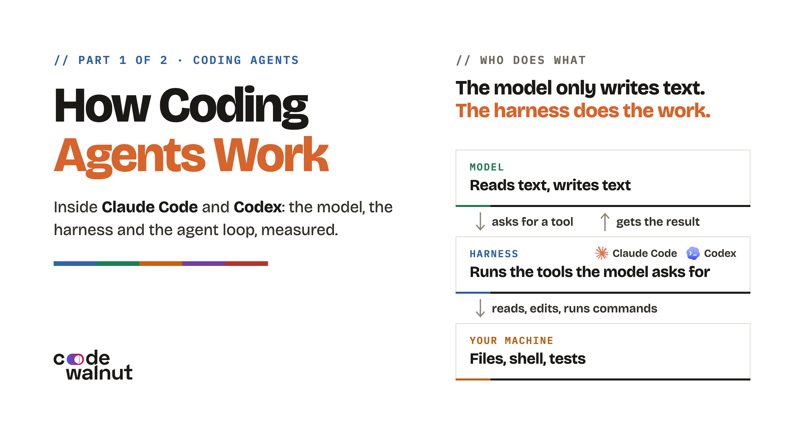
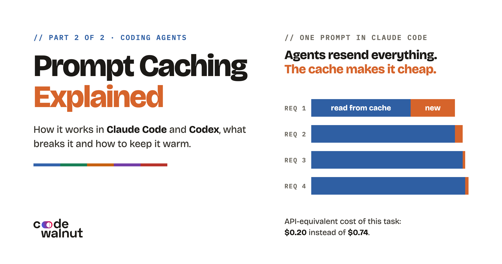
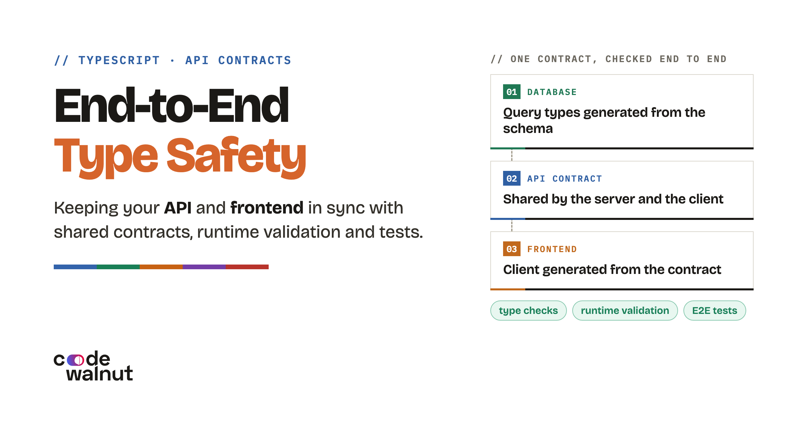

# Blog posts

Long-form engineering articles. Each folder holds one article, its figures and its social card.

## [How Coding Agents Work: Inside Claude Code and Codex](how-coding-agents-work/README.md)

How Claude Code and Codex work: the model, the harness and the agent loop, and why one bug fix took 4 and 6 model requests of 16,000+ tokens each.

14 November 2026 · 44 min read · Part 1 of 2

## [Prompt Caching Explained: How It Works in Claude Code and Codex](prompt-caching/README.md)

How prompt caching works in Claude Code and Codex: what it saves (about 80% in our tests), what breaks the cache, how long it lasts and how to check it.

14 November 2026 · 30 min read · Part 2 of 2

## [End-to-End Type Safety: Keeping Your API and Frontend in Sync](end-to-end-type-safety/README.md)

How end-to-end type safety catches API and frontend mismatches early, with shared contracts, runtime validation, and examples from real projects.

10 September 2026 · 8 min read · First published on [CodeWalnut](https://www.codewalnut.com/insights/end-to-end-type-safety-keeping-your-api-and-frontend-in-sync)

## What each folder holds

| File | What it is |
| --- | --- |
| `README.md` | The article. |
| `metadata.yml` | The page title, search description, keywords and Open Graph tags for publishing the article elsewhere. |
| `assets/og-image.png` | The social card shown when the article is shared. |
| `assets/*.svg`, `assets/*.png` | The figures. The SVGs embed their hand-drawn font, so they look the same anywhere. |
| `assets/*.excalidraw` | Editable sources for the figures. Open one at [excalidraw.com](https://excalidraw.com) to change or export it. |

## License

[MIT](LICENSE).
