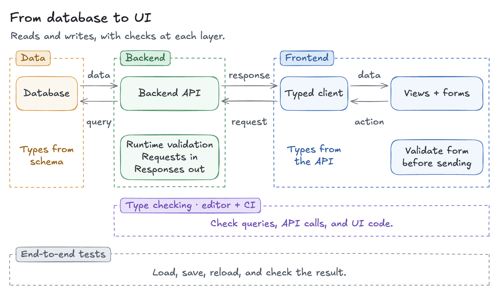
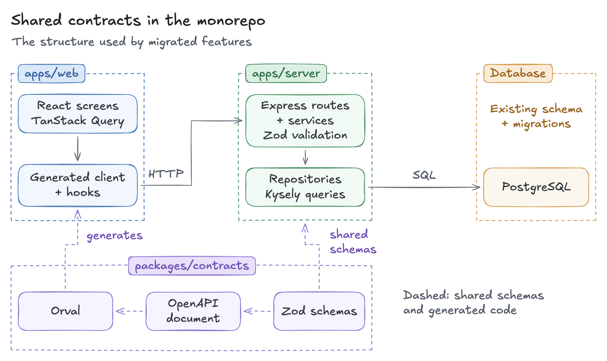

# End-to-End Type Safety: Keeping Your API and Frontend in Sync

By Vishnumohan R K · 10 September 2026 · 8 min read · Originally published on [CodeWalnut](https://www.codewalnut.com/insights/end-to-end-type-safety-keeping-your-api-and-frontend-in-sync)


A frontend and backend can each pass their type checks and still disagree on the data they exchange.

On one of the projects that I was working on, the frontend was built against an agreed response format. The backend response shape changed during implementation, and the mismatch surfaced when we connected the two. Each codebase’s type checks only covered its own version of the response.

End-to-end type safety connects the API contract to the code on both sides. When the contract changes, that connection helps identify incompatible code during development and/or during CI. The same checks remain useful when a future maintainer or coding agent works on the feature.

## Why both builds can pass

Imagine a team agreeing on a product-list response in Slack:

> **Backend:** The product-list API will return *id* and *name* for each product. Here is a sample response.
> **Frontend:** We’ll use *name* in the product list.

```json
[{ "id": "p1", "name": "fleet tracker" }]
```

The frontend developer turns that agreed response into a local type and renders the list in React:

```tsx
type Product = {
  id: string;
  name: string;
};

function capitalize(value: string) {
  return value.charAt(0).toUpperCase() + value.slice(1);
}

function ProductList({ products }: { products: Product[] }) {
  return (
    <ul>
      {products.map((product) => (
        <li key={product.id}>{capitalize(product.name)}</li>
      ))}
    </ul>
  );
}
```

With a mock matching the sample response, the page looks correct. Later, the backend team renames *name* to *productName* and updates its own types:

```json
[{ "id": "p1", "productName": "fleet tracker" }]
```

The frontend still uses the type copied from the Slack agreement. During integration, the API request succeeds, but *product.name* is now undefined. Calling *capitalize* throws during rendering:

```text
TypeError: Cannot read properties of undefined (reading 'charAt')
```

Both type checks can pass. The backend checks its updated response, and the frontend checks its old local type. Neither check compares the two descriptions. The team ends up comparing the live response with the Slack agreement or getting on a call to work out what changed.

An agreement in Slack or a call still depends on someone carrying later changes into the frontend code. In this example, the type checker only sees the handwritten *Product* type.

Calling fetched JSON a *Product[]* does not validate it either. TypeScript does not add those checks to the runtime. A [type assertion](https://www.typescriptlang.org/docs/handbook/2/everyday-types.html#type-assertions) can tell the checker to accept a description without inspecting the received values.

## Make the contract change visible

The missing connection is a maintained API contract that both sides follow. It needs to cover the requests, successful responses, and error cases.

Connect the backend to that contract, then derive or generate the frontend types from it. The frontend’s description of the API then follows changes to the contract without someone copying each change by hand.

For a REST API, use an OpenAPI document as the contract. Generate it from the backend’s API schemas, or write it first and build the backend against it. The server must actually implement the contract in either arrangement.

In our product example, regenerating the frontend types after the rename gives us:

```ts
// Generated from the updated contract.
export interface Product {
  id: string;
  productName: string;
}
```

Replace the handwritten declaration with an import of this generated *Product* type. The access to *product.name* in *ProductList* now fails type checking:

```text
Property 'name' does not exist on type 'Product'.
```

The fix is in the rendering code:

```tsx
<li key={product.id}>{capitalize(product.productName)}</li>
```

The developer gets the location of the incompatible access before integration. For a maintainer joining months later, the same check reduces the need to compare frontend types with the API documentation by hand.

Generated request functions connect the contract to the code that sends each request. If an update operation requires *productName*, TypeScript flags calls that omit it or supply the wrong value type while you write the code.

## Understand what each check tells you

Type checking catches the field rename before the feature runs. Runtime validation checks the values being exchanged, and tests check what the feature does for the user.

**Type checking catches incompatible code.** Your editor highlights the invalid *product.name* access as soon as it sees the updated type, while you are still coding. CI runs the type checker too. Enable TypeScript’s strict checks so that possibly missing values also require attention. Adding a new enum value does not automatically flag code that fails to handle it. Use [exhaustive checking](https://www.typescriptlang.org/docs/handbook/2/narrowing.html#exhaustiveness-checking) to turn missing cases into type errors.

**Runtime validation checks data against rules that types alone do not enforce.** A reference code may be a string, but it must also match a specific format defined by a regular expression. Also, complex forms often contain nested groups of fields with rules that depend on one another. Zod lets you define these format checks and relationships between fields in a schema.

Validate form data in the UI for immediate feedback, then again on the server before processing the request. Server validation covers request bodies, query parameters, and route parameters, including data submitted through POST or PUT requests. The backend also checks outgoing responses against their schemas before sending them. Generated types help developers use the expected data structure; the application must still run the validator to check the actual values.

**End-to-end tests check that a feature works as intended.** They exercise the UI and backend together and verify the result a user expects. In our example, a test that loads the product page and [checks the displayed names](https://playwright.dev/docs/best-practices#test-user-visible-behavior) would catch the rendering failure. A frontend test using an outdated mock could still pass. For an edit, save the change, reload the page, and check that the updated value appears. This checks the complete workflow, including whether the change was saved and displayed correctly.

> **Passing type checks does not prove a feature works.** Focused unit and API tests cover business rules and edge cases in more detail.

Compatible changes can pass all checks. An unused new field may leave the frontend unchanged. A backend mapping may preserve the public response after an internal database rename. The checker reports incompatible uses within the code and contract versions it examines.

Here is how these checks fit around the flow from database to UI, including requests that change data:



*Type checks examine code, runtime validators inspect values, and E2E tests exercise the whole journey.*

## Choose a strategy that fits your application

The aim is the same in every stack: keep the frontend’s request and response types connected to the backend API. Choose an approach that fits how your application already communicates.

| Approach | How the types stay connected |
| --- | --- |
| Typed RPC for TS Full Stack | The client infers inputs and results from the server API. |
| OpenAPI for a REST API | The OpenAPI document describes the API; a generator produces a client for the frontend language. |
| Code generation for a GraphQL API | A generator combines the schema with the frontend’s operations to produce their input and result types. |

With tRPC, the server definition supplies the types for both sides. Define a *getProducts* operation on the server, and the frontend infers its accepted inputs and returned fields. The frontend does not need a second, handwritten *Product* interface.

[OpenAPI](https://spec.openapis.org/oas/v3.1.1.html) describes HTTP APIs independently of the server language. Adding contract generation to an existing REST API is often a smaller change than adopting a new API architecture.

For a Java Spring Boot backend, Springdoc produces the OpenAPI document used to generate a TypeScript client. After renaming a published response field, regenerate the contract and client. Frontend code that still uses the old field becomes a type error. Include contract export in the build and make export failures stop it. [Springdoc’s Maven plugin documents the setup.](https://github.com/springdoc/springdoc-openapi-maven-plugin)

In a mixed-language application, that OpenAPI document is the common contract. Backend validation and contract tests check that the server implements it.

Swagger UI makes an OpenAPI document readable and lets engineers try requests. To detect incompatible frontend code, connect that document to generated types or contract checks as well. A documentation page alone cannot update a handwritten interface.

For an existing GraphQL API, [GraphQL Code Generator](https://the-guild.dev/graphql/codegen/docs/advanced/how-does-it-work) combines the schema and frontend operations to generate their input and result types. Adopting GraphQL also affects API design and client behavior, so it deserves a broader architecture decision.

I’ll cover all strategies in a follow-up post, including how to migrate an existing application incrementally, with working examples.

## How we added type safety incrementally

We recently refactored a fleet-management application to improve its architecture and code quality, making it easier for the team to maintain and extend.

We kept its Express backend and React frontend together in a single monorepo. The migrated features used TypeScript across the full stack. We added shared contracts for the APIs as we migrated each feature, while existing features continued to work.

A shared contracts package, *packages/contracts*, kept the Zod schemas for API requests and responses in one place. We used those schemas for runtime validation and generated an OpenAPI document from them. [Orval](https://orval.dev/docs/guides/react-query/) then generated the browser request functions and response types.

Orval also generated typed query and mutation hooks for TanStack Query. The generated client provided types for both success and error responses. Components checked the HTTP status and rendered the corresponding UI.

The migrated features followed this structure, with separate frontend and backend apps connected to the shared contracts package:



*Solid arrows show requests while the app runs. Dashed arrows show schema sharing and code generation during development.*

After a contract changed, regeneration updated the browser code. Type checking exposed incompatible uses of the new response. CI checked that generated files matched the current schemas and ran type checking. If a developer changed a schema but forgot to regenerate the client, the build failed.

These checks kept the definitions aligned and validated the exchanged data. E2E tests checked that the migrated features still worked by replaying user journeys against the running application. API tests covered contract compliance and individual rules in more detail.

## Extend the checks into the database

The same project used an existing PostgreSQL database. The client already had a process for database migrations, and changing it was outside our scope. We wanted table and column autocomplete, typed queries and results while preserving that process.

We chose [Kysely](https://kysely.dev/), a SQL query builder, with kysely-codegen. The generator inspected the existing database schema and produced TypeScript definitions. Kysely used those definitions to check queries. The editor suggested valid table names and then the columns available in the selected table, giving us the database typing we wanted within the existing workflow.

For illustration, consider a database with a *product* table:

```ts
const products = await db
  .selectFrom("product")
  .select(["id", "name"])
  .execute();
```

If the database column changes to *product_name*, regenerate the database types. A query still selecting *name* then fails type checking. That identifies the backend query requiring attention.

Keep generated database types current with the intended schema and the values returned by the database driver. A numeric column may arrive in JavaScript as text. [Kysely’s types do not transform those returned values.](https://kysely.dev/docs/recipes/data-types)

Drizzle and Prisma provide similar benefits through different APIs. [Drizzle](https://orm.drizzle.team/docs/get-started/postgresql-existing) infers query types from table definitions written in TypeScript. [Prisma](https://www.prisma.io/docs/orm/v6/overview/prisma-in-your-stack/is-prisma-an-orm) generates a client with model-specific query methods from its schema. Both support existing databases; choosing either does not by itself require replacing the client’s migration process. Kysely fitted our scope: we wrote queries in a familiar SQL style and checked them against types generated from the client’s database.

## Give developers and agents useful feedback

An agent working across the stack needs to understand what an API accepts, what it returns, and how the frontend uses the result. Connected types make that information explicit in the code. In a review insights application I built last year, Drizzle and tRPC connected database query types to the frontend.

After an API change, the type checker identifies incompatible uses in the connected code. The agent gets a specific file, field access, or argument to investigate. It can inspect the affected callers, update them, and run the check again. This gives it concrete feedback during implementation.

While building this application, I implemented a full-stack feature in about 15 minutes, mostly by accepting Cursor Tab suggestions. If autocomplete was already that useful, imagine what today’s frontier coding agents could do with the same code context and type-checking feedback.

A [monorepo brings related code and contracts together](https://www.cosx.ai/blogs/why-ai-agents-need-monorepos-not-just-better-prompts), giving an agent access to an API operation alongside its callers, tests, and repository conventions. For example, it can inspect an existing update operation to see how inputs are validated, then follow its caller to see how the screen responds after a save. These provide concrete patterns to follow when implementing the next feature.

For developers and agents, the related code provides context for choosing an edit, while type errors provide feedback for checking it. That reduces the need to reconstruct the contract from separate descriptions.

## Conclusion

The Slack example begins with a reasonable agreement and ends with two versions of the same response. End-to-end type safety gives the team a maintained connection between that agreement and the code using it.

Once the contract and client types are updated, the type checker identifies incompatible uses during development. Runtime validation checks the data being read or saved, and E2E tests check that the covered user journeys work as intended.

You don’t need to change the entire backend at once. Start with one API operation and extend the approach as you work on other features. The same checks help developers, future maintainers, and agents catch mismatches during development, before the next integration or demo.
