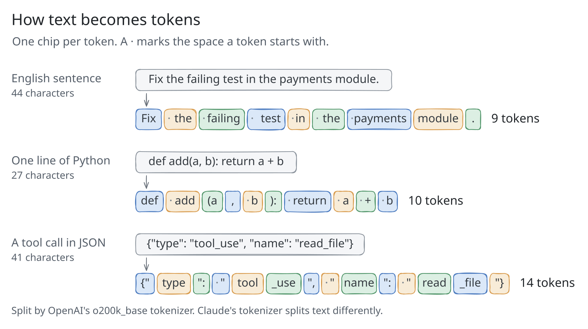
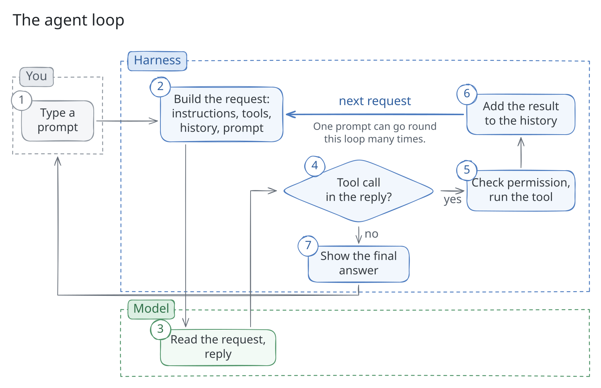
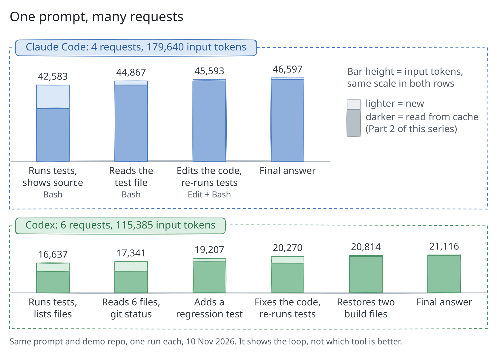

# How Coding Agents Work: Inside Claude Code and Codex

*What happens when you press Enter: the model, the harness, the loop, and every term in between, measured in both tools.*

By Vishnumohan R K · 14 November 2026 · 44 min read

A coding agent such as Claude Code or Codex is a language model inside a harness. The harness is a program that sends the model your request along with instructions and tool definitions, runs the tools the model asks for, sends the results back, and repeats until the model gives a final answer.

Claude Code is Anthropic's coding agent and runs Claude models. Codex is OpenAI's and runs GPT models. Both work the same way underneath.

We gave both agents the same prompt in the same small repository: two tests fail, find the root cause and fix it. Claude Code made 4 requests to its model to finish the job, and Codex made 6. Before either agent had opened a single file, its first request already held 42,583 tokens (Claude Code) and 16,637 tokens (Codex). About half of Claude Code's came from features of our account that your setup may not have.

Those numbers come from the loop that every coding agent runs. That loop explains much of what you notice in daily use: why the context window fills up, why the agent forgets a rule after compaction, and why every MCP server or skill you add costs tokens on every request. This guide takes Claude Code and Codex apart to show how coding agents work, one term at a time.

**In short**

- The model only reads text and writes text. It cannot open a file or run a command.
- The harness (Claude Code or Codex) runs a loop: send everything to the model, run the tools it asks for, send the results back, repeat.
- One prompt becomes several model requests, and each one carries the whole conversation. We measured 4 requests in Claude Code and 6 in Codex for the same bug fix.
- Before the agent reads a single file, its first request already carried 16,000 to 43,000 tokens in our setups, mostly instructions and tool definitions.
- Everything else in this guide (MCP, skills, subagents, compaction, memory) is about what goes into those requests, and when.

> **Tested with** Claude Code 2.1.321 (Claude Opus 5.5) and Codex CLI 0.167.0 (GPT-6.1 Sol) on 10 November 2026. See [how we measured](#how-we-measured).

This guide is long on purpose. Each section answers one question and stands alone. For the big picture, read up to [What does each request carry?](#what-does-each-request-carry); for any term, jump to the [glossary](#glossary).

> **Series:** this is Part 1 of 2. [Part 2, Prompt Caching Explained](../prompt-caching/README.md), shows why these large, repeated requests cost less than they look.

**Contents**

- The pieces: [What is a coding agent?](#what-is-a-coding-agent) · [The model](#the-model-what-an-llm-can-and-cannot-do) · [What is a harness?](#what-is-a-harness-model-vs-harness)
- The loop: [The agent loop](#what-happens-when-you-press-enter-the-agent-loop) · [Turns and requests](#turns-and-requests-why-one-prompt-makes-many-model-calls) · [Tool calling](#what-is-tool-calling) · [What each request carries](#what-does-each-request-carry)
- Context and memory: [Context window](#what-is-a-context-window) · [Compaction](#what-is-compaction) · [Memory](#memory-what-the-agent-remembers-and-what-it-doesnt) · [Subagents](#what-are-subagents)
- Extending the agent: [MCP](#what-is-mcp-and-an-mcp-server) · [Tool search](#what-is-tool-search-deferred-tools) · [Skills](#what-are-skills) · [Hooks and plugins](#what-are-hooks-and-plugins) · [CLI or MCP?](#cli-or-mcp-using-the-tools-already-on-your-machine) · [Which extension does what?](#skills-vs-mcp-vs-hooks-vs-subagents-vs-plugins-which-does-what)
- Safety and surfaces: [Permissions and the sandbox](#permissions-approvals-and-the-sandbox) · [Where they run](#where-they-run-cli-ide-desktop-app-web-and-sdk)
- Putting it together: [Claude Code vs Codex under the hood](#how-claude-code-and-codex-differ-under-the-hood) · [What this means for cost](#what-this-means-for-cost)
- Reference: [Glossary](#glossary) · [FAQ](#frequently-asked-questions) · [How we measured](#how-we-measured) · [Sources](#sources)

---

*The pieces*

## What is a coding agent?
A coding agent is an AI tool that reads your code, runs commands and edits files to complete a task you describe. Simon Willison's [short definition](https://simonwillison.net/2025/Sep/18/agents/) fits it well: "An LLM agent runs tools in a loop to achieve a goal."

Each word in that sentence maps to a part of Claude Code and Codex. The LLM is the model. The tools are actions such as reading a file, editing code or running the tests. The loop is the program that keeps calling the model, and the goal is your prompt.

A chat assistant answers with text, and you copy its code into your editor yourself. A coding agent does that work in your project. From Anthropic's [glossary](https://code.claude.com/docs/en/glossary): "Claude Code is agentic because it has tools that let it act, not just advise."

Two names cause confusion early. Claude is Anthropic's family of models, and Claude Code is the agent that uses them. In this guide, Codex means OpenAI's current coding agent (the CLI, the IDE extension, the Codex mode of the ChatGPT desktop app and Codex Cloud), not the 2021 model that was also called Codex.

You will also meet the phrase "agentic coding". It describes this way of working: the agent reads files, runs commands and makes changes while you watch, redirect it or step away.

## The model: what an LLM can and cannot do
The model is a large language model (LLM). It reads text (and images, such as a screenshot you paste) and writes text. On its own it cannot open files, run commands or browse the web.

A language model reads a sequence of tokens (pieces of text, explained below) and predicts the next one. The software appends that token and asks again, one token at a time, until the model signals that it has finished. Everything an agent produces, from a sentence to a tool call, is the model writing tokens this way.

Pretraining on large amounts of text teaches the prediction. Later training teaches the model to follow instructions, call tools and write code that passes tests. That later training is why current models make capable agents, and also why they reply in a predictable structure that a program can act on.

The model knows what was in its training data, up to a cutoff date. Current Claude models list June 2026, and GPT-6.1 Sol lists 30 April 2026. A library released after that date is unknown to the model until the agent reads its documentation or its installed source with a tool.

**The model keeps no memory between requests.** Its weights do not change while you work, and nothing you type teaches it. Anything an agent seems to remember is text that the harness saved and sends again. This one fact explains most of this guide: why every request is large, why the context fills up and why instruction files exist.

When Claude Code "reads a file", the model wrote a short structured request, Claude Code opened the file, and the contents went into the next request. Anthropic's [tool-use documentation](https://platform.claude.com/docs/en/agents-and-tools/tool-use/how-tool-use-works) states: "The model never runs anything on its own."

Current models also think before they answer. These reasoning (or thinking) tokens are billed as output tokens and are mostly hidden from you. Claude Code receives thinking blocks with an opaque signature and usually no readable text, and Codex receives encrypted reasoning items. Both harnesses keep them in the conversation so the model can continue its line of reasoning.

### What is a token?
A token is a piece of text, often a word or part of a word, that the model reads and writes. Models count, limit and bill everything in tokens: the size of a request, the size of the context window and the price.



*A model reads and writes tokens, not words. Dense code and JSON split into more tokens per character than plain English.*

OpenAI's rule of thumb is about 4 characters of English per token, and our counts with `o200k_base`, the tokenizer OpenAI publishes for its GPT-4o to GPT-5 models, came out at 4.4 to 4.9 for two plain sentences.

Anthropic says earlier Claude models averaged about 3.5 English characters per token, and current models produce about 30% more tokens for the same text, which works out to roughly 2.7. So 100,000 tokens in Claude Code and 100,000 tokens in Codex are not the same amount of text.

Code and JSON split into smaller pieces. A dense line of Python came out at 2.7 characters per token and a short JSON snippet at 2.9. Whole source files average closer to 4, because indentation and comments split cheaply. JSON matters most here, because tool definitions and tool calls are JSON, and so are many tool results, such as MCP responses.

## What is a harness? Model vs harness
A harness is the program around the model that turns its text into actions. Claude Code and Codex are harnesses. In Anthropic's [glossary](https://code.claude.com/docs/en/glossary): "Claude Code is the harness; Claude is the model inside it."

OpenAI describes the same split. Every Codex app, from the terminal to the desktop app, runs one Codex harness: the agent loop and its logic, which live in a component OpenAI calls Codex core. So a coding agent is a model plus a harness, and the harness is the part you install.

The harness does everything the model cannot:

- builds each request from instructions, tool definitions, history and your prompt;
- sends it to the model and reads the reply;
- runs the tools the model asks for;
- asks for your permission and enforces the sandbox;
- manages the context window, including compaction;
- loads instruction files and memory;
- saves the session so you can resume it.


*The model only reads and writes text. The harness turns its tool calls into real actions on your machine.*

[Anthropic's engineering team](https://www.anthropic.com/engineering/managed-agents) splits a hosted agent into three parts: "a session (the append-only log of everything that happened), a harness (the loop that calls Claude and routes Claude's tool calls to the relevant infrastructure), and a sandbox (an execution environment where Claude can run code and edit files)." Claude Code and Codex have all three.

In both, the session is the conversation file saved on disk, the harness is the program you run, and the execution environment is your machine or a cloud machine. The operating-system sandbox described under [permissions and the sandbox](#permissions-approvals-and-the-sandbox) is narrower: a boundary around commands, on by default in Codex and off by default in Claude Code.

The loop itself is small. The agent class of the [mini-swe-agent](https://github.com/SWE-agent/mini-swe-agent) research project is about 100 lines of Python, with a single tool, the shell, and its authors report over 74% on the SWE-bench Verified benchmark. Thorsten Ball's [tutorial](https://ampcode.com/how-to-build-an-agent) builds a working code-editing agent in a few hundred lines of Go.

Claude Code and Codex are large products because of everything around the loop: permissions and the sandbox, context management, instruction files, MCP, skills, subagents and several apps. Most of this guide is about those parts.

You will also see "harness engineering", a second use of the word. OpenAI and others use it for what you build around an agent: instruction files, scripts and tests that keep its work on track. This guide uses "harness" for the agent program itself.

---

*The loop*

## What happens when you press Enter: the agent loop
When you press Enter, the harness sends your prompt to the model with its instructions and tool definitions. If the reply asks for a tool, the harness runs the tool, adds the result to the conversation and calls the model again. The loop ends when a reply contains no tool call.

Step by step:

1. You type a prompt.
2. The harness builds a request (instructions, tool definitions, the conversation so far and your prompt) and sends it to the model.
3. The model reads the request and replies with text, one or more tool calls, or both.
4. The harness checks whether the reply contains a tool call.
5. If it does, the harness checks your permission settings and runs each tool.
6. It adds the results to the conversation and goes back to step 2 with the next request.
7. When a reply contains no tool call, the harness shows it as the final answer.



*One turn of a coding agent. The harness keeps calling the model until a reply contains no tool call.*

OpenAI's Michael Bolin [describes the Codex loop](https://openai.com/index/unrolling-the-codex-agent-loop/) the same way: the harness runs each tool call and appends its output, and the process repeats "until the model stops emitting tool calls". Anthropic describes Claude Code's loop for users as three phases, gather context, take action and verify results, which run on top of this mechanical loop.

You are part of the loop too. You can interrupt at any point and steer the agent with a new message, and the harness stops to ask you when an action needs your approval.

For engineers, here is the loop as simplified Python. Real harnesses add streaming, parallel tools, compaction, retries and much more.

```python
messages = [system_prompt, instruction_files, user_prompt]

while True:
    reply = model.generate(tools=TOOL_DEFINITIONS, messages=messages)
    messages.append(reply)

    tool_calls = [part for part in reply.content if part.type == "tool_call"]
    if not tool_calls:
        show(reply.text)      # final answer: the turn ends
        break

    for call in tool_calls:
        if allowed(call):     # permission mode, rules, or ask the user
            result = run_tool(call.name, call.input)
        else:
            result = "The user denied this action."
        messages.append(tool_result(call.id, result))
```

Notice that `messages` only grows. Every pass sends the whole list again, because the model keeps no memory of the previous request.

## Turns and requests: why one prompt makes many model calls
A turn is everything from your prompt to the agent's final answer. A request is one call to the model. One turn usually contains several requests, one for each pass through the loop.

A naming trap: Anthropic's Agent SDK calls each pass through the loop a "turn", and its `max_turns` setting counts model requests. This guide uses "turn" as the Claude Code and Codex apps do, for your prompt and the final answer.

We measured one turn in each tool with the same prompt and the same demo repository, a small Python library with two failing tests. Both agents fixed the bug.

| | Claude Code | Codex |
|---|---|---|
| Model requests | 4 | 6 |
| Tool calls | 4: `Bash`, `Bash`, then `Edit` and `Bash` in one reply | 5 calls to one `exec` tool, running 12 actions between them (see [tool calling](#what-is-tool-calling)) |
| First request | 42,583 tokens | 16,637 tokens |
| Input tokens, all requests | 179,640 | 115,385 |
| Output tokens | 1,306 | 913 |
| Time | 16 seconds | 27 seconds |



*One prompt to fix two failing tests became 4 requests in Claude Code and 6 in Codex. Every request carries the whole conversation.*

Each request is the previous request plus the model's last reply plus the new tool result. In Claude Code, the model's first reply asked to run the tests and print the source files, the second asked to read the test file, the third asked to edit the code and re-run the tests, and the fourth was the answer.

Codex took a slightly different path. It added a regression test, confirmed it failed, applied the fix, then restored two compiled files that the test run had changed. The task's own content, meaning results, code and replies, added only a few thousand tokens across the requests.

When the model asks for several tools in one reply, as Claude Code did in its third request, the harness runs them all and sends the results together. That costs one more request, not one per tool.

These are single runs, so they show how the loop behaves, not which tool is faster. In an earlier Codex run, the same prompt took 4 requests.

### Requests you never see
Both harnesses also send small requests that do not appear in the conversation:

- **Claude Code** sends a session-title request to Claude Haiku 5.5 (about 1,200 tokens), and through our logging proxy we also saw a start-up probe with `max_tokens: 1`.
- **Codex** sends a start-up "prewarm" request on the session's model, and a thread-title request to GPT-5.6 Luna (about 6,800 tokens).

Compaction, covered below, is also a full request. Neither tool lists these requests one by one in its normal interface.

## What is tool calling?
Tool calling is how a model asks the harness to do something. The harness describes each tool to the model, the model replies with a structured request naming a tool and its inputs, and the harness runs it and sends back the result.

A tool definition has three parts: a name, a description in plain English and an input schema. Here is Claude Code's shell tool, trimmed:

```json
{
  "name": "Bash",
  "description": "Executes a bash command and returns its output. …",
  "input_schema": {
    "type": "object",
    "properties": {
      "command": { "type": "string", "description": "The command to execute" },
      "description": { "type": "string", "description": "Clear, concise description of what this command does…" },
      "timeout": { "type": "number", "description": "Optional timeout in milliseconds…" }
    },
    "required": ["command"]
  }
}
```

The model reads that description like any other text. When it wants to run the tests, Claude Code receives a reply containing a `tool_use` block. This is the real block from our test run, trimmed:

```json
{
  "type": "tool_use",
  "id": "toolu_013AYQ3a…",
  "name": "Bash",
  "input": {
    "command": "python3 -m unittest discover -s tests -v 2>&1 | tail -40; cat src/invoice/*.py",
    "description": "Run tests and show source"
  }
}
```

Claude Code runs the command on your machine and sends the output in the next request as a `tool_result`, matched by the same id:

```json
{
  "type": "tool_result",
  "tool_use_id": "toolu_013AYQ3a…",
  "content": "test_discount_applies_before_tax … FAIL\n…\nRan 6 tests in 0.001s\n\nFAILED (failures=2)\n…",
  "is_error": false
}
```

The model never ran anything. It wrote a request, and the harness did the work and reported back.

### Codex writes code to call its tools

Codex takes a different approach in 2026, which OpenAI calls code mode. Every current model gets one main tool, `exec`, that accepts JavaScript. The model writes a short program, and inside it calls nested tools such as `exec_command` (the shell) and `apply_patch` (file edits).

Here is the real call from our test run in which Codex fixed the bug, trimmed. One request applied the patch, re-ran the tests and printed a summary of the diff:

```json
{
  "type": "custom_tool_call",
  "call_id": "call_5639d293…",
  "name": "exec",
  "input": "text(await tools.apply_patch(…));\ntext(await tools.exec_command(…));\ntext(await tools.exec_command(…));"
}
```

Decoded, the `input` is a three-line program:

```javascript
text(await tools.apply_patch("*** Begin Patch\n*** Update File: src/invoice/invoice.py …"));
text(await tools.exec_command({cmd: "python3 -B -m unittest discover -s tests -v"}));
text(await tools.exec_command({cmd: "git diff --stat"}));
```

The result comes back as a `custom_tool_call_output` with the same `call_id`. Every tool call in our Codex sessions was an `exec` call, and one of them read six files and ran `git status` at once. The model can chain several actions in one program.

Codex's [configuration reference](https://learn.chatgpt.com/docs/config-file/config-reference) still lists the code-mode feature switch as off by default. The model catalogue that Codex downloads sets every current model to code mode only, so that switch doesn't decide it, and every tool call we recorded went through `exec`.

Claude Code added an experimental, opt-in Code Mode in version 2.1.323, after our tests, in which Claude writes JavaScript to call its tools. Everything we measured in Claude Code used separate tools.

### The built-in tools

| | Claude Code | Codex |
|---|---|---|
| How tools are packaged | Separate JSON tools: 16 sent on our first request | One `exec` tool running JavaScript with 13 nested tools, plus about 10 small tools |
| Shell | `Bash` | `exec_command` (nested) |
| Edit files | `Edit`, `Write` | `apply_patch` (nested) |
| Read files | `Read`, or the shell | the shell |
| Search | the shell (`grep`, `find`) | the shell (`rg`) |
| Subagents | `Agent` | `spawn_agent` and five related tools |
| Ask you a question | `AskUserQuestion` | `request_user_input` |
| Load more tools | `ToolSearch` | Filters `ALL_TOOLS` inside `exec` |

Claude Code documents about 45 built-in tools, but only a core set is sent with every request. The rest are named in a list and loaded when needed (see [tool search](#what-is-tool-search-deferred-tools)). On macOS and Linux, Claude Code no longer sends separate `Glob` and `Grep` tools; it searches through the shell.

A few tools run on the provider's servers instead of your machine, such as web search in some setups. The model calls them the same way, and the result arrives without the harness running anything locally.

## What does each request carry?
Every request carries the full briefing: tool definitions, the system instructions, your instruction files, details about your environment, the conversation so far and your latest message. The model keeps nothing between requests, so every request must give it everything it needs.

Claude Code and Codex put the same kinds of content in a different order:

| Order | Claude Code | Codex |
|---|---|---|
| 1 | Tool definitions | Tool definitions |
| 2 | System prompt | Base instructions |
| 3 | First user message: CLAUDE.md or AGENTS.md, a git status snapshot, your prompt | Developer messages: skills list, sandbox and approval rules, subagent rules, deferred tool list |
| 4 | A message after the prompt: environment, date, skills list, subagent types, MCP server instructions, deferred tool names | User messages: AGENTS.md, environment and date, then your prompt |
| 5 | The conversation: replies, tool calls, tool results | The conversation: replies, tool calls, tool results |


*Before reading a single file, Claude Code's first request was 42,583 tokens and Codex's 16,637. Tool definitions are the largest part in both.*

Some of that size depends on the account. Connected services, organisation skills and a browser extension added about 8,000 tokens on our Claude Code setup. Our closest-to-default run, started with `claude --safe-mode`, which also leaves out the project's CLAUDE.md and auto memory, began at 32,602. Even that run carried Artifact, a 12,469-token tool for publishing pages that comes with our plan; we could not tell whether other plans send it.

Without the plugin skills on our account, Codex's first request would have been about 15,500 tokens, an estimate from character counts.

After the first request, the history grows with every tool result. That is why the conversation, not the fixed start, eventually fills the context window.

Rereading everything is by design. Claude Code sends the whole request every time. Codex, over its WebSocket connection, sends only the new items and points to its previous response, but the model still reads the whole conversation, and usage counts all of it. Providers make this cheaper by caching the unchanged start of each request, the subject of [Part 2 on prompt caching](../prompt-caching/README.md#why-coding-agents-need-prompt-caching).

To see your own numbers, run `/context` in Claude Code, which draws the context window as a grid by category (its split is an estimate, and its total matches the real request once one has been sent), or `/status` in Codex, which shows how much of the window is left.

---

*Context and memory*

## What is a context window?
The context window is the most text a model can consider in one request, including the reply it writes. Everything in the request counts: tool definitions, instructions, the conversation, tool results and the model's own output.

The sizes, as each tool uses them on 10 November 2026:

- **Claude Code on Claude Opus 5.5:** a 1,000,000-token window, with up to 128,000 tokens of output per request. Automatic compaction starts at about 967,000 tokens.
- **Codex on GPT-6.1 Sol:** a 500,000-token window by default, which `/status` shows as 475,000 usable. In our session it reported "98% left (22.4K used / 475K)", because its percentage leaves out a fixed 12,000-token baseline. Automatic compaction starts at 90%, about 450,000 tokens. OpenAI's API lists larger windows for its GPT-6 models; Codex uses its own default.

What fills the window is mostly tool results: file contents, command output and search results. Both harnesses cap a single result. Claude Code saves shell output over about 30,000 characters to a file and shows the model the path and a preview; MCP results over 25,000 tokens also go to a file, and the model gets the path. Codex caps each command's output at 10,000 tokens by default.

A bigger window is not automatically better. Anthropic's [context-window documentation](https://platform.claude.com/docs/en/build-with-claude/context-windows) says that "as token count grows, accuracy and recall degrade, a phenomenon known as *context rot*." [Chroma's 2025 study](https://www.trychroma.com/research/context-rot) of 18 models found that performance became less reliable as inputs grew, even on simple tasks. An older study, ["Lost in the Middle"](https://arxiv.org/abs/2307.03172), found that models used information at the start and end of a long input better than the middle.

That is why agents compact old history, hand side tasks to subagents and load files only when they need them. The idea has a name, context engineering, which [Andrej Karpathy described](https://x.com/karpathy/status/1937902205765607626) as "the delicate art and science of filling the context window with just the right information for the next step."

## What is compaction?
Compaction is how an agent keeps working when the context window fills up. The harness asks the model to summarise the conversation so far, then replaces the old history with that summary.


*Compaction replaces the conversation history with a summary. The fixed parts stay, and the agent gets room to keep working.*

**In Claude Code**, compaction runs automatically near the limit (about 967,000 tokens on 1M-token models), or when you type `/compact`. You can add a focus, such as `/compact focus on the API changes`. After compaction, Claude Code puts back what it needs to continue:

| Kept or restored after compaction | How |
|---|---|
| System prompt | Unchanged |
| Project CLAUDE.md and auto memory | Re-read from disk |
| Skill descriptions | Rebuilt |
| Git status | A fresh snapshot |
| Recently edited or read files | Up to five re-read, most recent first; files over 5,000 tokens come back as a path only |
| Skills used in the session | Re-attached, up to 5,000 tokens each and 25,000 in total |
| Everything else in the conversation | Only what the summary kept |

**In Codex**, compaction starts automatically at 90% of the window, or when you type `/compact`. With OpenAI models, the summary is made on OpenAI's servers and comes back as one encrypted item, which OpenAI's [compaction guide](https://developers.openai.com/api/docs/guides/compaction) describes as carrying forward "key prior state and reasoning" in a form that is "not intended to be human-interpretable".

Codex keeps your recent messages (up to 64,000 tokens) and drops the assistant replies, tool calls and tool outputs, whose content survives only inside that encrypted item. It then adds the instructions, AGENTS.md and environment again.

Compaction is a request too, and it reads the whole history. In our trial a Codex compaction request read 30,658 tokens, and a Claude Code compaction read about 55,000. On a long session that request is large.

The restored files and lists use some of the freed space again. In our Claude Code session, the request after `/compact` was 47,400 tokens, down from 53,700, because the recent files, skills and tool lists came back with the summary.

Details that the summary leaves out are gone. This explains one common kind of "why did it forget what we agreed?": the instruction lived only in the conversation, and compaction summarised it away.

`/clear` is different. It starts a new conversation with an empty history, keeping only what loads at start-up, such as your instruction files. Use `/clear` when the next task is unrelated, and `/compact` when you want to continue the same work with a shorter history.

Compaction also replaces the history the provider had cached, so the request after it reuses only the fixed start from the cache. [Part 2](../prompt-caching/README.md#what-breaks-the-cache-in-claude-code-and-codex) shows what that costs.

## Memory: what the agent remembers, and what it doesn't
A coding agent has no memory of its own. "Memory" in these tools means text files that the harness reads from disk and puts into the request, plus the saved conversation you can resume.

[Anthropic's engineers](https://www.anthropic.com/engineering/effective-harnesses-for-long-running-agents) describe the problem with an analogy: "Imagine a software project staffed by engineers working in shifts, where each new engineer arrives with no memory of what happened on the previous shift." Instruction files, memory files and saved sessions are the handover notes.

### Instruction files: CLAUDE.md and AGENTS.md

An instruction file is a Markdown file of project rules and context that the agent loads at the start of every session: how to run the tests, which conventions to follow, what not to touch.

**Claude Code** reads `CLAUDE.md` files from your working folder and every folder above it, plus your personal `~/.claude/CLAUDE.md`, and joins them. Files in subfolders load when the agent works on files there. A `CLAUDE.md` can import other files with `@path/to/file`. Anthropic suggests keeping each file under 200 lines, because longer files cost more context and are followed less reliably.

**Codex** reads `AGENTS.md`: a global one in `~/.codex`, then one per folder from the repository root down to your working folder. Later files appear later in the request, so the file closest to your work wins a conflict. Codex stops adding files at 32 KiB and reads them once per session; in our trial, an edit made mid-session was not picked up.

Since version 2.1.277, Claude Code also reads `AGENTS.md` when there is no `CLAUDE.md` in the working folder or any folder above it. To use one file for both agents, keep `AGENTS.md` and add a one-line `CLAUDE.md` that imports it with `@AGENTS.md`, as our demo repository did. AGENTS.md is an open format, now looked after by the Linux Foundation's [Agentic AI Foundation](https://www.linuxfoundation.org/press/linux-foundation-announces-the-formation-of-the-agentic-ai-foundation).

Claude Code puts the instruction files in the first user message, wrapped in a "system reminder", not in the system prompt. Codex puts AGENTS.md in a user message before your prompt.

Anthropic's [memory documentation](https://code.claude.com/docs/en/memory): "Claude treats them as context, not enforced configuration." A rule in an instruction file is a strong request. For a rule that must never be broken, use a hook or a permission rule (see [hooks](#what-are-hooks-and-plugins)).

### Notes the agent writes for itself

**Claude Code's auto memory** is on by default. Claude writes short notes about your corrections and preferences into a memory folder for the project. An index file, `MEMORY.md`, loads at the start of every session (the first 200 lines or 25 KB), and the agent reads the individual notes when they look relevant.

**Codex memories** exist but are off by default. When you turn them on, Codex extracts useful context from earlier chats in the background. A summary of up to 2,500 tokens goes into the instructions, and the agent searches the memory files when it needs more. OpenAI's [advice](https://learn.chatgpt.com/docs/customization/memories): keep required team guidance in AGENTS.md and treat memories as a recall layer.

### Saved sessions

Both tools save every conversation to a file on your machine. Resuming a session (`/resume` or `claude --continue` in Claude Code, `codex resume` in Codex) sends the saved conversation to the model again. Nothing is restored inside the model; the harness replays the text.

### Why did it forget?

When an agent "forgets", one of four things usually happened:

1. **Compaction** summarised away a detail.
2. **A new session** started with only the instruction and memory files.
3. **The rule was only said in chat**, so it was never written to a file that loads next time.
4. **The instruction file is long**, and the rule is one line among hundreds.

## What are subagents?
A subagent is a separate agent with its own context window. The main agent hands it a side task, such as searching a large codebase, and gets back only a summary, so the search results never fill the main conversation.

**Claude Code** starts subagents with its `Agent` tool. It ships with Explore (fast, read-only search), Plan (research during plan mode) and general-purpose agents, and you can define your own in Markdown files. Subagents run in the background by default. A "fork" is a subagent that inherits the whole conversation so far and shares its cache.

**Codex** runs each subagent as its own thread, addressed by a path such as `/root/<task_name>`, using tools such as `spawn_agent` and `wait_agent`. Up to four run at once by default. Current Codex releases only start subagents when you, AGENTS.md or a skill ask for it, except at the highest ("Ultra") reasoning effort.

The trade-off is cost. A subagent keeps your main context clean, but it makes its own model requests with its own instructions. In our trial, one Claude Code subagent's first request was about 30,000 tokens on its own. Codex's [subagent documentation](https://learn.chatgpt.com/docs/agent-configuration/subagents) warns that "subagent workflows consume more tokens than comparable single-agent runs."

Both tools also offer ways to coordinate many agents: Claude Code has agent teams (experimental) and dynamic workflows, and Codex agents can message each other and take follow-up tasks. The [glossary](#glossary) defines them.

---

*Extending the agent*

## What is MCP (and an MCP server)?
MCP, the Model Context Protocol, is an open standard for connecting AI applications to outside tools and data. An MCP server is a program that offers tools (and sometimes data and prompt templates) to any app that speaks MCP, such as Claude Code or Codex.

Anthropic released MCP in November 2024 and donated it to the Linux Foundation's Agentic AI Foundation in December 2025.

MCP has three roles. The host is the app you use, here Claude Code or Codex. For each server it connects to, the host creates a client, the connection itself. The server is the program on the other end, for example GitHub's server or a database server.

Servers come in two kinds. A local server runs as a process on your machine and talks over standard input and output (stdio). A remote server runs elsewhere and you reach it at a URL over HTTP, usually with a sign-in.

To the model, an MCP tool looks like any other tool: a name, a description and an input schema. Both tools name them `mcp__<server>__<tool>`, for example `mcp__github__issue_read`. You add servers with `claude mcp add` or a project `.mcp.json` file in Claude Code, and with `codex mcp add` or `config.toml` in Codex.

The [official analogy](https://modelcontextprotocol.io/docs/getting-started/intro) is "a USB-C port for AI applications": one plug instead of a custom integration for every app. It holds for compatibility. Three things the analogy leaves out:

- **Connected tools cost tokens.** Their definitions travel in requests, unless tool search defers them (next section).
- **The harness makes the call, not the model.** The model only asks; Claude Code or Codex sends the request to the server.
- **A server is running code with your credentials.** Claude Code's sandbox covers shell commands only, and OpenAI's Michael Bolin [wrote in January 2026](https://openai.com/index/unrolling-the-codex-agent-loop/) that MCP tools "are not sandboxed by Codex and are responsible for enforcing their own guardrails." Codex 0.163.0 added a sandbox launcher that local MCP servers can use; we did not test it. Add servers you trust.

An MCP server costs tokens twice: its tool definitions, and the results its tools return. A result enters the context once and then travels with the history in every later request, so one large result can cost more than all the definitions.

We connected GitHub's official MCP server to both tools, read-only and with its default toolsets. It offered 28 tools, and 27 of them reached the model (the 28th, `ui_get`, serves MCP Apps and was never sent). With default settings, it made the first request 974 tokens larger in Claude Code and 20 tokens larger in Codex. The next section explains why so little.

The results cost more. One `issue_read` call, which fetches a single issue, returned about 1,900 characters of JSON in Claude Code and 2,700 in Codex (for different issues). That added about 750 and 814 tokens to the next request (not counting the model's own call), and to every request after it in the session.

## What is tool search (deferred tools)?
Tool search lets an agent keep many tools available without sending all their definitions in every request. The harness sends only the tool names, and the model loads a full definition when it decides to use that tool.

The problem it solves is real. [Anthropic measured](https://www.anthropic.com/engineering/advanced-tool-use) five common MCP servers at "58 tools consuming approximately 55K tokens before the conversation even starts", with GitHub's server alone at about 26,000. Anthropic also found that models choose tools less accurately once they have more than 30 to 50 to pick from.

**In Claude Code**, tool search is on by default. MCP tools and the less-used built-in tools are listed by name in the request under a line that begins "The following deferred tools are now available via ToolSearch". When the model needs one, it calls `ToolSearch`, and Claude Code adds the full definition to the next request.

On our Claude Code setup, the first request listed 91 deferred tool names, which cost 1,706 tokens. The closest-to-default run listed 21 names for 230 tokens. You can turn tool search off with `ENABLE_TOOL_SEARCH=false`, or mark a server you use constantly with `alwaysLoad` so its tools are sent up front.

**In Codex**, MCP tools are deferred by default too, and the old switches that turned tool search off are retired. In code mode there is no search tool. The model writes a short script inside `exec` that filters a list called `ALL_TOOLS`, and the matching tools come back as the script's output. A per-server setting, `omit_tools_from`, sends a server's tools up front instead.

### What GitHub's server cost, deferred and up front

We started fresh sessions with the prompt "Reply with just OK." (in Codex, "Reply with just OK. Do not run any tools.") and compared the first request with and without GitHub's server. To send its tools up front, we used `alwaysLoad` in Claude Code and `omit_tools_from` in Codex.

| First request of a fresh session | Claude Code | Codex |
|---|---:|---:|
| No MCP server | 39,918 | 16,659 |
| GitHub connected, tools deferred (default) | 40,892 (+974) | 16,679 (+20) |
| GitHub's 27 tools sent up front | 51,900 (+11,982) | 23,360 (+6,701) |


*With tool search, the default in both agents, GitHub's 27 tools cost under 1,000 tokens per request until one is used. Sent up front, they cost 6,700 to 12,000 in every request.*

With tools deferred, Claude Code sent the 27 GitHub tool names, three tools for reading MCP resources, and GitHub's server instructions of about 1,800 characters. Codex sent no tool names at all, only one line naming the server:

```text
<tools>
Deferred tool namespaces:
- mcp__codex_tui
- mcp__github: The GitHub MCP Server provides tools to interact with GitHub platform.
</tools>
```

`mcp__codex_tui` is the Codex app's own tool namespace, present in every session.

In Codex, the up-front tools went inside `exec`, as code mode presents them; as separate function tools they added 5,573 instead. All the up-front numbers include GitHub's server instructions, and the two agents count with different tokenizers. Anthropic's widely quoted 26,000 tokens for GitHub's server was for 35 tools; the read-only default set we used has 27.

Turning tool search off in Claude Code costs far more than GitHub's tools. `ENABLE_TOOL_SEARCH=false` also sends Claude Code's own deferred tools in full, so the first request grew to 81,160 tokens with no MCP server at all, and to 94,266 with GitHub connected.

### Loading a tool: the extra round trip

In the session with tools deferred, we then asked for the title of one GitHub issue. Both agents took three requests, and the first of them only loaded the tool.

| Request | Claude Code | Codex |
|---|---|---|
| 1 | Calls `ToolSearch` with `select:mcp__github__issue_read` (40,925 tokens) | Runs a script that filters `ALL_TOOLS` for `issue_read` (16,711) |
| 2 | Calls `mcp__github__issue_read` (41,596) | Calls `tools.mcp__github__issue_read(...)` inside `exec` (17,530) |
| 3 | Answers with the title (42,468) | Answers with the title (18,387) |

In Claude Code, the tool search result holds only a reference to the tool. Claude Code then adds the full definition, about 500 tokens, to the `tools` list of the next request, and keeps it there for the rest of the session:

```json
{ "type": "tool_use", "name": "ToolSearch",
  "input": { "query": "select:mcp__github__issue_read", "max_results": 1 } }

{ "type": "tool_result",
  "content": [ { "type": "tool_reference", "tool_name": "mcp__github__issue_read" } ] }
```

In Codex, the script's output is the tool's description and a TypeScript declaration of its arguments, about 770 tokens here. Codex appends GitHub's full server instructions to every tool it returns, so a search that matches three tools brings back three copies.

The cost of tool search is one extra request when a tool is first needed, and that request carries the whole context. Sending GitHub's tools up front instead added about 12,000 tokens to every request in Claude Code and 5,600 to 6,700 in Codex, whether the tools were used or not.

Neither app shows the loading step in the conversation. `/mcp` lists 28 tools for GitHub whether they are deferred or sent up front. Claude Code's `/context` marks MCP tools as "loaded on-demand"; we found no equivalent in Codex.

## What are skills?
A skill is a folder containing a `SKILL.md` file: a name, a one-line description and instructions for a task, plus optional scripts and reference files. Skills teach the agent how to do something with the tools it already has.

Skills rely on progressive disclosure, which means loading detail only when it is needed:

1. **Always loaded:** each skill's name and description, in every request.
2. **Loaded when used:** the full `SKILL.md` instructions.
3. **Loaded if needed:** extra reference files in the skill's folder.
4. **Never loaded:** scripts. The agent runs them, and only their output enters the context.

**In Claude Code**, the skill list arrives in a message after your prompt. The model loads a skill by calling the `Skill` tool, or you invoke one directly with `/skill-name`. Once loaded, the instructions stay in the conversation. Custom commands are now skills too: `.claude/commands/deploy.md` and `.claude/skills/deploy/SKILL.md` both create `/deploy`.

**In Codex**, the skill list (name, description and file path) is a developer message, capped at 2% of the context window. The model reads `SKILL.md` itself with a shell command, or you mention a skill with `$skill-name`, and Codex inserts the full instructions into the conversation.

The list is not free. On our Claude Code setup, 31 skill descriptions cost 6,204 tokens per request, and the 17 built-in skills on the closest-to-default run cost 2,872. Codex listed 16 skills, most of them from plugins on our account.

To see what one skill costs, we wrote `changelog-entry`, a 63-line skill (2,441 characters) that writes a `CHANGELOG.md` entry for uncommitted changes. We installed the same text in both tools, made a one-line bug fix, and asked for a changelog entry twice: once by the skill's name, and once in plain words.

| `changelog-entry` skill | Claude Code | Codex |
|---|---|---|
| Listing, in every request | +76 tokens (one 215-character line) | +124 tokens (one 250-character line, plus a folder path) |
| Called by name | `/changelog-entry` adds the body to your message, with no tool call | `$changelog-entry` adds the body as a `<skill>` message |
| "Add a changelog entry for these changes" | The model called the `Skill` tool, which took one extra request | The model read `SKILL.md` with `cat` inside `exec` |
| Body, once loaded | About 900 tokens | About 680 tokens injected, or about 670 when read with `cat` |
| Stays in later requests | Yes | Yes |

Both agents chose the skill from the plain request on their own, and all four runs wrote a correct `### Fixed` entry. In Codex, the run called by name also read `SKILL.md` with `cat` after Codex had already inserted it, so the body entered the context twice. Codex's own instructions tell the model to avoid re-reading skills.

So this skill cost about 100 tokens per request until it was used, and 700 to 900 tokens for the rest of the session after that, or about 1,350 in the Codex run that loaded it twice. Longer descriptions cost more: our 31 listed skills averaged about 200 tokens each.

Both tools follow the Agent Skills open standard, so a skill written for one usually works in the other. Simon Willison [called skills](https://simonwillison.net/2025/Oct/16/claude-skills/) "maybe a bigger deal than MCP" when they launched. The reason is cost: a skill adds knowledge for one line of context until it is used, without adding tools.

## What are hooks and plugins?
A hook is your own script that the harness runs at a fixed point in the loop, for example before a tool runs, after a file edit or when a turn ends. The harness runs it every time, whatever the model decides.

That is why hooks suit rules that must always hold. From Anthropic's [guide to extending Claude Code](https://code.claude.com/docs/en/features-overview): "An instruction like 'never edit `.env`' in CLAUDE.md or a skill is a request, not a guarantee. A `PreToolUse` hook that blocks the edit is enforcement."

Hooks cost no context unless they return output for the model. Claude Code supports events such as `SessionStart`, `PreToolUse`, `PostToolUse` and `Stop`. Codex supports a similar set, and in code mode its hook decisions also apply to the tool calls inside an `exec` script.

A plugin is an installable bundle of skills, subagents, hooks and MCP servers, usually from a marketplace. Claude Code manages them with `/plugin`. Codex plugins come from one directory shared by ChatGPT and Codex. In a separate Codex session, adding one more plugin with 16 skills made the first request 1,873 tokens larger, and its skill list stays in every request after that.

## CLI or MCP? Using the tools already on your machine
If a good command-line tool exists and the agent has a shell, the CLI is often the simpler choice. MCP is the better fit when there is no CLI, when you need a per-user sign-in, when the agent has no shell, or when you want each action to be a named tool you can permit separately.

The shell is a coding agent's most general tool. The model already knows `git`, `gh`, `npm`, `kubectl`, `aws` and `psql` from its training. A CLI adds no tool definitions, and the agent can filter its output with `--json`, `jq` or `grep` before the result enters the context.

[Mario Zechner](https://mariozechner.at/posts/2025-11-02-what-if-you-dont-need-mcp/) made that case in 2025. [Armin Ronacher](https://lucumr.pocoo.org/2025/8/18/code-mcps/) argued that an MCP server should expose code rather than dozens of tools, and Cloudflare's ["Code Mode"](https://blog.cloudflare.com/code-mode/) and Anthropic's ["Code execution with MCP"](https://www.anthropic.com/engineering/code-execution-with-mcp) both have the model write code that calls tools. Codex's code mode builds that idea into the harness.

MCP still has clear advantages:

- **Many services have no CLI**, and an MCP server is often their supported integration.
- **Sign-in**: remote servers handle per-user OAuth, while a CLI's stored credentials are within reach of any command the agent runs (`gh auth token` prints GitHub's).
- **No shell**: web, desktop chat and mobile apps reach tools through MCP.
- **Permissions**: each MCP tool is a named action you can allow, block or require approval for. A shell command is free text, which is harder to allow-list safely.
- **Structured results**: MCP tools can declare the shape of their output.

### The same task through `gh` and through GitHub's MCP server

We gave each agent the same task twice: "Look at issue #N in pallets/click and the pull request that fixed it. Summarise the bug, the fix, and the files the pull request changed." One run ended "Use the gh CLI." and had no MCP server. The other ended "Use the GitHub MCP tools." and had no `gh`.

| Run | Requests | Input tokens | Time | Answer |
|---|---:|---:|---:|---|
| Claude Code with `gh` | 3 | 129,562 | 20.5 s | Correct |
| Claude Code with GitHub MCP | 4 | 183,111 (+41%) | 22.9 s | Correct, one small slip |
| Codex with `gh` | 3 | 53,034 | 14.0 s | Correct |
| Codex with GitHub MCP | 4 | 78,063 (+47%) | 22.4 s | Correct |

Each agent worked on a different issue: Claude Code on #3802, whose fix changed four files, and Codex on #3886, a nine-line documentation fix. Compare the two runs within each agent, not across agents. The slip: Claude Code's MCP run said three closed pull requests were "labelled 'AI junk'"; that was their title, and their label was "rejected AI".

Most of the gap is the loading step. Each MCP run spent one request finding its tools, and that request carried the whole context: about 41,000 tokens in Claude Code and 17,000 in Codex. In Claude Code, the three loaded definitions (about 2,200 tokens) stayed in every later request, and the server's names and instructions added about 975 tokens to every request, as in the earlier test.

In Codex, the search result was 11,138 characters, and 5,406 of them were GitHub's server instructions, repeated once for each of the three tools it found. That result then stayed in the context for the rest of the task. The MCP results themselves were also wordier than `gh` output with the same facts: 7,161 characters against 5,091.

The results added little to Claude Code's gap: 21,837 characters through MCP against 17,722 through `gh`, partly because the `gh` run cut the diff with `head -300`.

After cache discounts, the MCP runs cost 29% more in Claude Code and 46% more in Codex at API list prices. Both MCP runs batched their calls: Claude Code made two calls per request, and Codex made three in one script with `Promise.allSettled`.

One practical difference showed up in Codex. The `gh` run needed one setting changed: the `workspace-write` sandbox has no network by default. MCP calls run outside the sandbox and needed no change.

One run each is not a benchmark, and the result sizes depend on the tools and flags the model picks. The loading request, the per-request overhead and the size of each loaded definition are part of the design, so expect them in your own sessions.

A rule of thumb:

1. Use the CLI when a well-known one exists and the agent runs with a shell.
2. Use an MCP server when there is no CLI, when you need per-user sign-in, when the surface has no shell, or when you need per-action permissions.
3. Add a skill to teach the agent how your team uses either one.
4. Check the cost in your own setup with `/context` and `/status`, and watch large tool results more than definitions.

## Skills vs MCP vs hooks vs subagents vs plugins: which does what?
Each extension changes a different part of the loop. Instruction files and skills add text the model reads, MCP adds tools, subagents move work into another context window, hooks run your code at fixed points, and plugins package the others.

| Extension | When it enters the context | Who decides | Claude Code | Codex |
|---|---|---|---|---|
| Instruction file | Every request | No one: it always loads | `CLAUDE.md` (or `AGENTS.md`) | `AGENTS.md` |
| Skill | Description every request; body when used | The model, or you by name | `SKILL.md`, `/name` | `SKILL.md`, `$name` |
| MCP server | Tool names (Claude Code) or server name (Codex) every request; a definition once loaded | The model | `claude mcp add`, `.mcp.json` | `codex mcp add`, `config.toml` |
| Tool search | One extra request when a new tool is needed | The model | `ToolSearch` | `ALL_TOOLS` in code mode |
| Subagent | Its types or rules every request; only its summary comes back | The model or you (Codex: only when asked) | `Agent` tool | `spawn_agent` |
| Hook | Never, unless it returns output | The harness, every time | `hooks` in settings | `hooks.json` or `config.toml` |
| Plugin | As its parts | You, when you install it | `/plugin` | Plugin directory |


*Extensions differ in when they enter the model's context. Hooks, scripts and subagents do their work outside it.*

---

*Safety and surfaces*

## Permissions, approvals and the sandbox
Two controls limit what a model can do on your machine. Permissions decide when the agent must ask you before acting. The sandbox limits what a command can reach once it runs, enforced by the operating system.

Both controls exist because asking about every step does not work. [Anthropic found](https://www.anthropic.com/engineering/claude-code-auto-mode) that "Claude Code users approve 93% of permission prompts", and that approval fatigue sets in: people "stop paying close attention to what they're approving." Classifiers and sandboxes let the agent work without a prompt for every step, while the sandbox still limits what its commands can reach.

**Claude Code** calls the first control the permission mode. Since version 2.1.283, interactive sessions in the terminal and VS Code start in [auto mode](https://code.claude.com/docs/en/permission-modes): "A separate classifier model reviews actions before they run, blocking anything that escalates beyond your request, targets unrecognized infrastructure, or appears driven by hostile content Claude read." Anthropic adds that auto mode "reduces permission prompts but does not guarantee safety."

The other Claude Code modes are Manual (asks before anything except reads), `acceptEdits` (file edits without asking), `plan` (read and propose, no edits), `dontAsk` for locked-down scripts, and `bypassPermissions` for isolated containers only. Permission rules such as `Bash(npm run *)` allow, ask or deny specific actions, and deny rules apply in every mode.

Claude Code's [sandbox](https://code.claude.com/docs/en/sandboxing) is separate and off by default. Turn it on with `/sandbox`, and shell commands can then write only inside your project and reach only the network domains you allow. It covers shell commands, not Claude's file tools or MCP servers.

**Codex** keeps the two controls as two settings. The sandbox mode is `read-only`, `workspace-write` or `danger-full-access`. The approval policy is `on-request` or `never`, or a granular mix. In a git repository, Codex starts with `workspace-write` and `on-request`, and the network is off for commands unless you allow it.

Codex can also send approval requests to a separate reviewer agent instead of you, shown as "Approve for me" in the desktop app. Its sandbox covers every command the agent starts, including `git`, package managers and test runners, but not MCP tools.

| | Claude Code | Codex |
|---|---|---|
| When it asks | Permission mode (auto by default) plus allow, ask and deny rules | Approval policy (`on-request` by default), rules for command prefixes |
| Who approves | You, or the auto-mode classifier | You, or an auto-review agent |
| What commands can reach | Bash sandbox, off by default | Sandbox mode, `workspace-write` by default |
| Operating-system mechanism | Seatbelt (macOS), bubblewrap (Linux) | Seatbelt (macOS), bubblewrap and seccomp (Linux), native isolation (Windows) |
| Not covered by the sandbox | File tools, MCP servers, hooks | MCP tools |

Claude Code also saves a [checkpoint](https://code.claude.com/docs/en/checkpointing) at every prompt, and `/rewind` restores your files or the conversation to that point. Checkpoints cannot undo actions on remote systems, such as a database change or a deployment.

## Where they run: CLI, IDE, desktop app, web and SDK
Every Claude Code app runs the same harness, and so does every Codex app. What changes between them is where the agent runs: on your machine, with your files and settings, or in a cloud virtual machine with a fresh copy of your repository.


*Every Claude Code and Codex app runs the same harness. The difference is whether it works on your machine or in a cloud VM.*

**Claude Code** runs on your machine in the terminal, in VS Code (the extension bundles its own copy of the CLI), in JetBrains IDEs (the plugin runs the CLI) and in the desktop app. Sessions started at claude.ai/code, or from Slack, run in Anthropic-managed cloud machines. The mobile app and Remote Control are screens for sessions that run elsewhere.

For automation, Claude Code's non-interactive mode (`claude -p`) runs one prompt and exits. The [Agent SDK](https://code.claude.com/docs/en/agent-sdk/overview) for Python and TypeScript "runs the Claude Code binary", and Anthropic's GitHub Action is built on it.

**Codex** has one open-source engine, Codex core, behind an App Server that every app talks to. The CLI, `codex exec` for scripts, the IDE extension, the Codex mode of the ChatGPT desktop app and the SDK use it on your machine. Codex Cloud, Slack requests and GitHub code reviews run it in OpenAI-hosted machines.

| Where the agent runs | Claude Code | Codex |
|---|---|---|
| Your machine | CLI, VS Code, JetBrains, desktop app, `claude -p`, Agent SDK | CLI, `codex exec`, IDE extension, desktop app, SDK |
| A cloud machine | claude.ai/code, Slack, cloud scheduled tasks | Codex Cloud, Slack and Teams, GitHub code review |
| Remote screen only | Mobile app, Remote Control | Mobile app (cloud or a connected computer) |

Cloud sessions start from a fresh clone of your repository. They read the instruction files and skills checked into it, but not the personal settings on your laptop. If an agent behaves differently in the cloud, check what lives only in your home folder.

---

*Putting it together*

## How Claude Code and Codex differ under the hood
Claude Code and Codex run the same loop and solve the same problems. They differ in engineering choices: how they package tools, where they place each part of a request, and how they compact and sandbox. This table compares mechanisms, not quality.

| | Claude Code 2.1.321 | Codex CLI 0.167.0 |
|---|---|---|
| Model in our tests | Claude Opus 5.5 | GPT-6.1 Sol |
| Tool packaging | Separate JSON tools (`Bash`, `Read`, `Edit`…) | One `exec` tool running JavaScript that calls nested tools |
| First request, our setup | 42,583 tokens (32,602 closest to default) | 16,637 tokens |
| Instruction file | `CLAUDE.md`, or `AGENTS.md` when there is none | `AGENTS.md` |
| Context window | 1,000,000 tokens | 500,000 tokens (475,000 shown as usable) |
| Automatic compaction | About 967,000 tokens, summary written by the model | 90% of the window, encrypted summary from OpenAI's servers |
| Asking and sandbox | Permission modes (auto by default); sandbox off by default | Approval policy plus sandbox mode (`workspace-write` by default) |
| Subagents | `Agent` tool, background by default | Agent threads, up to four at once, on request |
| Skills | `/name` or the `Skill` tool | `$name`, or the model reads `SKILL.md` |
| Deferred tools | Names listed; loaded with `ToolSearch` | Server named in one line; found by filtering `ALL_TOOLS` inside `exec` |
| Source code | Not open source | Codex core and CLI are open source |

Claude Code's first request was larger in tokens on our accounts, but the two tools count tokens differently, and the 12,469-token Artifact tool on our Claude Code plan accounts for much of the gap.

Both let the model do several actions per request: Claude Code through parallel tool calls and chained shell commands, Codex by writing one program that calls several tools.

## What this means for cost
In our bug-fix run, Claude Code read 179,640 input tokens to produce 1,306 tokens of output. Both providers make that affordable by caching the unchanged start of each request: 90.5% of those input tokens in Claude Code, and 85.6% in Codex, were read from cache at a much lower price.

How that cache works, what breaks it, and how to check it in your own sessions is the subject of [Part 2 of this series: Prompt Caching Explained](../prompt-caching/README.md).

When an agent surprises you, look at the loop: what the harness sent in the request, what the model asked for, and what came back. Both apps show most of it: `/context` and `/status` for what fills the window, and the session files on disk for every request. The [glossary](#glossary) defines each term along the way.

> **Next in this series:** [Prompt Caching Explained: How It Works in Claude Code and Codex](../prompt-caching/README.md).

---

## Glossary
**Agent (coding agent):** a model inside a harness that runs tools in a loop until it finishes the task you described.

**Agent SDK:** Anthropic's Python and TypeScript library for building agents on the Claude Code harness; `claude -p` is its command-line form.

**Agent team:** an experimental Claude Code feature in which several sessions work as a team with a lead and can message each other.

**AGENTS.md:** an open format for agent instruction files. Codex reads it, and Claude Code reads it when there is no CLAUDE.md in the working folder or any folder above it.

**Approval policy:** Codex's setting for when the agent must stop and ask you, such as `on-request` or `never`.

**App Server:** the JSON-RPC layer through which every Codex app talks to Codex core.

**Auto memory:** notes Claude Code writes for itself about your preferences and corrections, loaded at the start of each session through `MEMORY.md`.

**Auto mode:** Claude Code's default permission mode, in which a classifier model reviews actions instead of asking you about each one.

**Checkpoint:** a snapshot Claude Code saves at every prompt so you can undo file changes with `/rewind`.

**CLAUDE.md:** Claude Code's instruction file, loaded into every request.

**CLI:** a command-line interface. Both agents have one, and so do tools such as `git` and `gh`.

**Code mode:** Codex's way of calling tools: the model writes JavaScript for one `exec` tool, which calls nested tools. Claude Code added an experimental, opt-in Code Mode in version 2.1.323, after our tests.

**Compaction:** replacing the conversation history with a summary when the context window fills up.

**Connector:** an MCP server added to your Claude or ChatGPT account rather than configured in the agent.

**Context engineering:** choosing what goes into the context window for each step.

**Context rot:** the drop in accuracy as the context grows longer.

**Context window:** the most text the model can consider in one request, including its reply.

**Deferred tool:** a tool whose full definition stays out of the request until the model loads it through tool search. Claude Code lists deferred tools by name; Codex names only their server.

**Dynamic workflow:** a Claude Code feature in which the model writes a script that runs many subagents in the background.

**Effort:** a setting for how much the model thinks before replying. Higher effort means more reasoning tokens.

**Fork:** a Claude Code subagent that starts with the whole conversation so far instead of a fresh context.

**Harness:** the program around the model that builds requests, runs tools and manages context. Claude Code and Codex are harnesses.

**Hook:** your script that the harness runs at a fixed point in the loop, every time.

**Input tokens:** everything sent to the model in a request.

**LLM (large language model):** the model that reads and writes tokens, such as Claude Opus 5.5 or GPT-6.1 Sol.

**MCP (Model Context Protocol):** an open standard for connecting agents to outside tools and data.

**MCP server:** a program that offers tools to agents over MCP.

**Non-interactive mode:** running an agent on one prompt from a script (`claude -p`, `codex exec`). It used to be called headless mode.

**Output tokens:** everything the model writes, including tool calls and reasoning.

**Permission mode:** Claude Code's setting for which actions run without asking you.

**Plan mode:** a mode in which the agent researches and proposes a plan without editing files.

**Plugin:** an installable bundle of skills, subagents, hooks and MCP servers.

**Prompt caching:** the provider's reuse of the unchanged start of a request at a lower price. [Part 2](../prompt-caching/README.md#what-is-prompt-caching) covers it.

**Reasoning (thinking) tokens:** tokens the model spends thinking before it replies, billed as output and mostly hidden.

**Request:** one call to the model. A turn usually contains several.

**Sandbox:** an operating-system boundary that limits which files and network addresses an agent's commands can reach.

**Session (thread):** one saved conversation. Codex calls it a thread.

**Skill:** a folder with a `SKILL.md` file of instructions, plus optional scripts and references, loaded only when needed.

**Subagent:** a separate agent with its own context window that returns a summary to the main agent.

**System prompt:** the base instructions the harness sends with every request.

**System reminder:** text Claude Code adds to the conversation for the model, such as your CLAUDE.md or the skills list.

**Token:** a piece of text, often a word or part of a word, that models read, write and bill.

**Tool:** an action the harness offers the model, such as reading a file or running a command.

**Tool calling:** the model replying with a structured request to use a tool, which the harness runs.

**Tool result:** the output of a tool, sent to the model in the next request.

**Tool search:** loading a deferred tool's full definition when the model needs it. Claude Code uses its `ToolSearch` tool; Codex in code mode filters a list called `ALL_TOOLS`.

**Training cutoff:** the date after which the model has no knowledge from its training data.

**Turn:** everything from your prompt to the agent's final answer.

## Frequently asked questions
### Is Claude Code the same as Claude?
No. Claude is the family of models. Claude Code is the agent that runs a Claude model and gives it tools to read and edit files and run commands. The same model in the Claude chat app has a different harness and different tools.

### Is Codex the same as the old Codex model?
No. The 2021 Codex was a model. Today's Codex is OpenAI's coding agent (CLI, IDE extension, desktop app and Codex Cloud), and it runs current GPT models such as GPT-6.1 Sol.

### How does Claude Code work?
Claude Code is a harness that runs a Claude model in a loop. When you press Enter, it sends the model its tool definitions, system prompt, your CLAUDE.md, the conversation so far and your prompt. It runs the tools the model asks for, such as shell commands, file edits and MCP tools, and sends the results back until the model replies without a tool call. In our test, one bug fix took 4 model requests.

### How does Codex work?
Codex runs the same kind of loop around a GPT model, in an open-source engine called Codex core. The main difference is code mode: the model writes a short JavaScript program for one `exec` tool, and that program calls the shell, file edits and MCP tools. In our test, the same bug fix took 6 model requests.

### Why does my context fill up so fast?
Every request carries the tool definitions, the instructions and the whole conversation, and every tool result (file contents, command output, MCP responses) stays in the conversation for the rest of the session. Large outputs fill it fastest. Run `/context` in Claude Code or `/status` in Codex to see how full it is, and use `/compact` or `/clear` when it gets large.

### Does the model remember my last session?
No. The model keeps nothing between requests. A new session starts with your instruction files and memory files. Resuming an old session sends its saved conversation again.

### Why does it forget things after compacting?
Compaction replaces the conversation with a summary, and details the summary leaves out are gone. Put rules that must last in CLAUDE.md or AGENTS.md, which come back after compaction: Claude Code re-reads them from disk, and Codex re-adds the copy it read when the session started.

### Why does it ignore my CLAUDE.md or AGENTS.md?
Instruction files are context, not enforced settings, and long files are followed less reliably. Keep them short, and use hooks or permission rules for anything that must never happen.

### Should I use /clear or /compact?
Use `/clear` when the next task is unrelated: it starts empty. Use `/compact` to continue the same task with a shorter history. Compaction is a full request over your history, so it has a cost.

### Do I need MCP?
Not if a good CLI does the job and the agent has a shell. Use MCP for services without a CLI, for per-user sign-in, for apps without a shell, or when you want per-action permissions.

### How many tokens does an MCP server use?
With tool search on, the default in both agents, very few until a tool is used. GitHub's 27-tool server added 974 tokens per request in Claude Code and 20 in Codex. Sent up front, the same tools cost about 12,000 and 5,600 to 6,700. Each tool result then stays in the context for the rest of the session.

### Skills or MCP?
They solve different problems. MCP adds tools; a skill adds instructions for using the tools you have, including MCP tools. Many setups use both.

### Does Claude Code read AGENTS.md?
Yes, since version 2.1.277, when there is no CLAUDE.md in the working folder or any folder above it. To use both, import AGENTS.md from a one-line CLAUDE.md with `@AGENTS.md`.

### Does the CLI use more tokens than the desktop app?
Each tool's apps run the same harness, so a request has the same structure in each. Differences come from what each app and setup loads, such as connected services, skills, plugins and app-specific tools; we measured only the CLIs. Check with `/context` or `/status`.

## How we measured
All measurements were made on 10 November 2026 on macOS, in one small demo repository: a Python library with six tests, two of which failed for one root cause. The bug-fix prompt was "Two tests fail in this repo. Find the root cause, fix it, and run the tests." The project had a one-line CLAUDE.md that imported an AGENTS.md of about 45 lines.

- **Claude Code 2.1.321**, signed in with a Claude Team subscription, model Claude Opus 5.5 at the default medium effort, auto permission mode.
- **Codex CLI 0.167.0**, signed in with a ChatGPT Pro subscription, model GPT-6.1 Sol at the default low effort, `workspace-write` sandbox with `on-request` approvals.

For Claude Code, request sizes are the usage numbers recorded per request in the session file, and the requests themselves come from Claude Code's own request records. We sized each part of the first request with Anthropic's token-counting endpoint, as the difference between the full request and the request without that part. The counted total was 0.3% below the billed total (42,450 against 42,583).

For Codex, request sizes come from the usage record that Codex saves for each request. Codex does not report the size of each part, so we inferred the tool and instruction sizes from where the cached tokens stopped, and estimated the smaller parts from character counts. We read Codex's open-source code at release `rust-v0.167.0` to confirm how requests are built.

Each scenario ran once, so the numbers show how the loop behaves, not average performance.

Both accounts had extras that a fresh install would not have, such as connected services and organisation skills; we report a closest-to-default run alongside. For Claude Code, that run used `claude --safe-mode --strict-mcp-config`, which leaves out connected services, organisation skills, the project's CLAUDE.md and auto memory. We used public documentation and real requests, not leaked source.

For the MCP, tool search and skill measurements, we connected GitHub's remote MCP server at `https://api.githubcopilot.com/mcp/` in read-only mode (the `X-MCP-Readonly: true` header, and in Claude Code also the `/mcp/readonly` path) with its default toolsets. It listed 28 read-only tools, and 27 reached the model in both agents. We read only public issues and pull requests in `pallets/click` and `pallets/flask`.

Claude Code ran with `--strict-mcp-config`, so only the servers we passed in loaded, plus the 20 tools of its built-in Claude in Chrome server. Its first request without MCP was 39,918 tokens, below the 42,583 of the main run, which also loaded the account's connected services. Codex kept its closest-to-default settings, with every MCP setting passed as a `-c` override.

To send GitHub's tools up front, we set `alwaysLoad: true` in Claude Code and `omit_tools_from` in Codex; to turn tool search off in Claude Code, `ENABLE_TOOL_SEARCH=false`. The `gh` runs used gh 2.103.3 with a token in `GH_TOKEN`. In the MCP runs, `gh` was off the PATH, and in Claude Code also blocked with a deny rule, because its shell restores the login shell's PATH.

The `changelog-entry` skill had identical text in both agents, in `.claude/skills/` for Claude Code and `.agents/skills/` for Codex.

## Sources
**Claude Code documentation** (read 10 November 2026): [How Claude Code works](https://code.claude.com/docs/en/how-claude-code-works) · [Glossary](https://code.claude.com/docs/en/glossary) · [Tools reference](https://code.claude.com/docs/en/tools-reference) · [Context window](https://code.claude.com/docs/en/context-window) · [Memory](https://code.claude.com/docs/en/memory) · [MCP](https://code.claude.com/docs/en/mcp) · [Skills](https://code.claude.com/docs/en/skills) · [Subagents](https://code.claude.com/docs/en/sub-agents) · [Permission modes](https://code.claude.com/docs/en/permission-modes) · [Extend Claude Code](https://code.claude.com/docs/en/features-overview) · [Agent loop (Agent SDK)](https://code.claude.com/docs/en/agent-sdk/agent-loop) · [Agent SDK overview](https://code.claude.com/docs/en/agent-sdk/overview) · [Sandboxing](https://code.claude.com/docs/en/sandboxing) · [Checkpointing](https://code.claude.com/docs/en/checkpointing)

**Codex documentation** (read 10 November 2026): [Glossary](https://learn.chatgpt.com/docs/glossary) · [AGENTS.md](https://learn.chatgpt.com/docs/agent-configuration/agents-md) · [Sandboxing](https://learn.chatgpt.com/docs/sandboxing) · [Approvals and security](https://learn.chatgpt.com/docs/agent-approvals-security) · [MCP](https://learn.chatgpt.com/docs/extend/mcp) · [Skills](https://learn.chatgpt.com/docs/build-skills) · [Subagents](https://learn.chatgpt.com/docs/agent-configuration/subagents) · [Hooks](https://learn.chatgpt.com/docs/hooks) · [Models](https://learn.chatgpt.com/docs/models) · [Configuration reference](https://learn.chatgpt.com/docs/config-file/config-reference) · [Memories](https://learn.chatgpt.com/docs/customization/memories) · [Source code](https://github.com/openai/codex)

**Vendor engineering posts:** Michael Bolin, [Unrolling the Codex agent loop](https://openai.com/index/unrolling-the-codex-agent-loop/) · Celia Chen, [Unlocking the Codex harness](https://openai.com/index/unlocking-the-codex-harness/) · Ryan Lopopolo, [Harness engineering](https://openai.com/index/harness-engineering/) · Anthropic, [Building effective agents](https://www.anthropic.com/engineering/building-effective-agents) · [Effective context engineering for AI agents](https://www.anthropic.com/engineering/effective-context-engineering-for-ai-agents) · [Introducing advanced tool use](https://www.anthropic.com/engineering/advanced-tool-use) · [Code execution with MCP](https://www.anthropic.com/engineering/code-execution-with-mcp) · [Effective harnesses for long-running agents](https://www.anthropic.com/engineering/effective-harnesses-for-long-running-agents) · [Scaling Managed Agents](https://www.anthropic.com/engineering/managed-agents) · [How we built Claude Code auto mode](https://www.anthropic.com/engineering/claude-code-auto-mode)

**Standards and model documentation:** [Model Context Protocol introduction](https://modelcontextprotocol.io/docs/getting-started/intro) · [MCP specification changelog, 2026-07-28](https://modelcontextprotocol.io/specification/2026-07-28/changelog) · [Agent Skills](https://agentskills.io) · [AGENTS.md](https://agents.md) · [Anthropic token counting](https://platform.claude.com/docs/en/build-with-claude/token-counting) · [Anthropic context windows](https://platform.claude.com/docs/en/build-with-claude/context-windows) · [OpenAI key concepts](https://developers.openai.com/api/docs/concepts) · [Anthropic, how tool use works](https://platform.claude.com/docs/en/agents-and-tools/tool-use/how-tool-use-works) · [OpenAI compaction guide](https://developers.openai.com/api/docs/guides/compaction) · [Linux Foundation, Agentic AI Foundation](https://www.linuxfoundation.org/press/linux-foundation-announces-the-formation-of-the-agentic-ai-foundation)

**Independent writing and research:** Simon Willison, [on defining agents](https://simonwillison.net/2025/Sep/18/agents/) and [Claude Skills are awesome, maybe a bigger deal than MCP](https://simonwillison.net/2025/Oct/16/claude-skills/) · Thorsten Ball, [How to Build an Agent](https://ampcode.com/how-to-build-an-agent) · [mini-swe-agent](https://github.com/SWE-agent/mini-swe-agent) · Chroma, [Context Rot](https://www.trychroma.com/research/context-rot) · Liu et al., [Lost in the Middle](https://arxiv.org/abs/2307.03172) · Andrej Karpathy on [context engineering](https://x.com/karpathy/status/1937902205765607626) · Mario Zechner, [What if you don't need MCP at all?](https://mariozechner.at/posts/2025-11-02-what-if-you-dont-need-mcp/) · Armin Ronacher, [Your MCP Doesn't Need 30 Tools: It Needs Code](https://lucumr.pocoo.org/2025/8/18/code-mcps/) · Cloudflare, [Code Mode](https://blog.cloudflare.com/code-mode/)

**Changelog:** 10 November 2026, first version.
