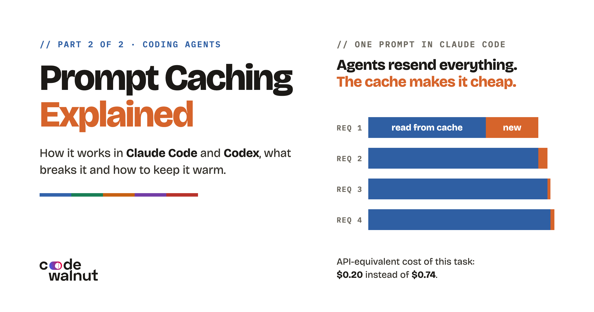
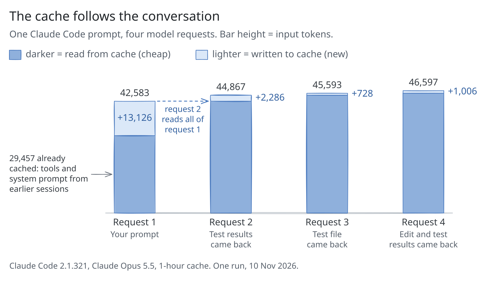

# Prompt Caching Explained: How It Works in Claude Code and Codex

*What the provider reuses between requests, what that saves, what breaks it and how to check it, measured in both tools.*

By Vishnumohan R K · 14 November 2026 · 30 min read



Prompt caching is what lets a coding agent resend your whole session on every request without paying full price each time. In [Part 1 of this series](../how-coding-agents-work/README.md), one prompt to Claude Code became 4 model requests carrying 179,640 input tokens, and 90.5% of those tokens came from the provider's cache.

Priced at API list rates, that task came to $0.20 with the cache and $0.74 without it, and Codex's run of the same task came to $0.05 instead of $0.24. Both ran on subscriptions, where the same difference shows up as plan usage and waiting time rather than dollars. The gap grows as a session gets longer, and a few everyday actions, such as switching models or coming back after a long break, take it away for a request or more.

Every number in this guide is measured in my own sessions, documented by a vendor or its staff, or computed from those, and I say which.

**In short**

- Prompt caching lets the provider reuse its work on the unchanged start of a request. It never returns a stored answer: every reply is generated fresh.
- Coding agents resend the whole conversation on every request, so most of each request matches the one before. In my sessions, 86% to 99% of input tokens per task came from cache, and 97.9% over a six-week client project run from one Codex thread.
- Cache reads cost 2.5% to 10% of the normal input price on current models. In my two short tasks, caching cut the API-equivalent cost by about 80% in both tools.
- The cache lasts minutes: 5 minutes or 1 hour in Claude Code, depending on how you sign in, and at least 30 minutes by default on OpenAI's API. OpenAI gives no lifetime for Codex on a ChatGPT plan; in my test the conversation was no longer cached after 35 minutes. After a longer break, the next request processes the conversation again.
- In my tests, switching models, compacting, starting a new session and long breaks caused misses. Changing effort, editing an instruction file and resuming a session did not.
- Claude Code reports your hit rate in `/usage`. Codex prints cached tokens when you quit and records them for every request in its session files.

> **Tested with** Claude Code 2.1.321 (Claude Opus 5.5) and Codex CLI 0.167.0 (GPT-6.1 Sol) on 10 November 2026. Prices checked the same day. See [how I measured](#how-i-measured).

> **Series:** this is Part 2 of 2. [Part 1](../how-coding-agents-work/README.md) explains how a coding agent works: the model, the harness, the agent loop and what each request carries.

**Contents**

- The idea: [What is prompt caching?](#what-is-prompt-caching) · [Why coding agents need prompt caching](#why-coding-agents-need-prompt-caching) · [How it works](#how-prompt-caching-works)
- In the tools: [Prompt caching in Claude Code and Codex](#prompt-caching-in-claude-code-and-codex) · [What breaks the cache](#what-breaks-the-cache-in-claude-code-and-codex) · [How long the cache lasts](#how-long-the-cache-lasts-ttl)
- In practice: [What it costs and saves](#what-prompt-caching-costs-and-saves) · [How to check your cache hit rate](#how-to-check-your-cache-hit-rate) · [Habits that keep the cache warm](#habits-that-keep-the-cache-warm)
- Reference: [FAQ](#frequently-asked-questions) · [How I measured](#how-i-measured) · [Sources](#sources)

---

## What is prompt caching?
Prompt caching is a feature of model providers such as Anthropic and OpenAI. When a request starts with exactly the same tokens as a recent request, the provider reuses the work it already did on that start instead of processing it again. The reused part is billed at a much lower price and processed faster. The answer is still generated fresh.

In daily use, this means:

- **It covers the start of the request only.** A request reuses the cache at most up to the first token that differs from the earlier request, and nothing after that point.
- **It saves money, waiting time and plan usage.** It does not make the conversation smaller: [cached tokens still count](https://platform.claude.com/docs/en/build-with-claude/context-windows) toward the context window.
- **It is automatic.** Claude Code and Codex use it throughout a session without any setting.

The name overlaps with other kinds of cache. Neither Claude Code nor Codex caches answers for model calls:

| Name | What is stored | Who runs it | Can it change the answer? |
|---|---|---|---|
| Prompt caching | The model's keys and values for the start of a request | The model provider, between requests | No |
| KV cache (inside one request) | The same values, kept while the model writes one reply | The inference server, during a single request | No |
| Response cache | A finished answer, keyed by the exact request | Your application | Yes: it returns an old answer |
| Semantic cache | A finished answer, keyed by similar meaning | Your application | Yes: it can return an answer to a different question |

### Words used in this guide

| Term | Meaning here |
|---|---|
| Request | One call to the model API. Billing, usage numbers and caching all work per request. |
| Turn | Your prompt and everything until the agent's final answer, usually several requests. |
| Prefix | The start of a request, from its first token up to some point. |
| Cache write | Processing part of a request and storing the result for later requests. On current API models it costs 1.25 to 2.5 times normal input, depending on the lifetime. |
| Cache read (cache hit) | Reusing a stored prefix. It costs a small fraction of normal input. |
| Uncached input | Tokens processed normally, neither read from the cache nor written to it. |
| Lifetime (TTL) | How long a stored prefix stays available after it was last used. TTL stands for time to live. |
| Hit rate | The share of input tokens that were read from cache. |
| Cache miss | A request that could not read its start from the cache and had to process it again. |
| Warm cache | A stored prefix that has not expired, so the next request can read it. |
| Cache mark (breakpoint) | A point in a request where the provider stores the prefix; `cache_control` on Anthropic's API. |

## Why coding agents need prompt caching
The model keeps nothing between requests, so every request has to carry everything: tool definitions, system instructions, your instruction files, the conversation so far and the newest tool result. [Part 1](../how-coding-agents-work/README.md#what-does-each-request-carry) showed what that looks like. Before reading a single file, the first request was 42,583 tokens in Claude Code and 16,637 in Codex.

Anthropic's [Messages API is stateless](https://platform.claude.com/docs/en/build-with-claude/working-with-messages), so Claude Code sends the full conversation every time. Codex, over its WebSocket connection, sends only the new items and points to its previous response, but the model still reads the whole conversation, and [every earlier input token in the chain is billed as input again](https://developers.openai.com/api/docs/guides/conversation-state).

So each request is the previous request plus a little more. In my Claude Code bug fix, the four requests were 42,583, 44,867, 45,593 and 46,597 tokens. Each one began with everything the previous one sent, then added the model's last reply and the newest tool result.



*Each request starts with everything the previous request sent. The cache returns that part, and only the new tool result and reply are processed and written.*

Without a cache, the provider would process that repeated start again on every request. Because each request is larger than the last, the total grows much faster than the number of requests. It is like rereading a whole book before answering each new question about it.

In January 2026, when Codex still resent the full conversation every time, Michael Bolin of OpenAI [asked](https://openai.com/index/unrolling-the-codex-agent-loop/) whether the agent loop is "quadratic in terms of the amount of JSON sent to the Responses API over the course of the conversation", and answered: "And you would be right." The model still reads the whole conversation today, which is why he adds: "When we get cache hits, sampling the model is linear rather than quadratic."

Each request still costs more than the last, because every cached token is billed again each time it is read, at a much lower price.

The same holds at project scale. I brought a client's full-stack JavaScript app, a rewrite of their legacy system that had been vibe-coded with an AI agent, up to production grade: architecture and code-quality fixes, a proper repository structure and quality gates, with no feature work. One Codex desktop thread ran it for six weeks, directing worker agents.

That thread's 805 turns made about 41,200 model requests carrying 6.07 billion input tokens, and 97.9% of them were read from cache. Without the cache, all 6.07 billion would have been processed at the full input price. [Part 1](../how-coding-agents-work/README.md#what-is-compaction) covers how the same thread got through 298 compactions.

## How prompt caching works
A model handles a request in two phases. First it reads the whole input, a phase usually called prefill. Then it writes the reply one token at a time. Reading the input is where a long request spends most of its time before the first word of the answer appears.

While reading, the model computes internal values for every token at every layer, called keys and values. Each later token looks back at the keys and values of every token before it, and so does every token of the reply. Keeping them for the length of one request is the KV cache; prompt caching keeps them after the request ends.

The prompt cache stores those [key-value tensors, not the tokens themselves](https://developers.openai.com/api/docs/guides/prompt-caching). Anthropic holds them [in memory only](https://platform.claude.com/docs/en/build-with-claude/prompt-caching): they are "held in memory only and are not stored at rest."

### Why only the start of a request can be reused

In every layer after the first, a token's keys and values depend on every token before it. Change one token, and the values for every later token change too, even where the text is identical. So a stored result is valid from the first token up to the first difference, and not one token further.

The match is exact in both tools. A change anywhere in the prefix [recomputes everything after it](https://code.claude.com/docs/en/prompt-caching), with no per-file or per-segment caching, and OpenAI's cache [needs the entire rendered prefix to match](https://developers.openai.com/api/docs/guides/prompt-caching).


*A request can reuse the cache only up to the first difference. Everything after a change is processed again, and a different model has its own cache.*

Developers who use Docker already know this rule from its [build cache](https://docs.docker.com/build/cache/): "Once a layer changes, then all downstream layers need to be rebuilt as well. Even if they wouldn't build anything differently, they still need to re-run." A prompt is a stack of layers in the same sense, from the tool definitions at the bottom to your newest message at the top.

The analogy has limits. Docker's cache stays on your disk until you prune it, while the prompt cache sits in the provider's memory for minutes. A Docker cache hit is free, while a cache read is billed at a reduced price. And an unchanged Dockerfile gives the same image, while the model writes a new answer every time.

### Cache writes and cache reads

The first request that sends a prefix pays to process it and to store it. That is a cache write. On Anthropic's API a write costs 1.25 times the normal input price for a 5-minute lifetime, or 2 times for 1 hour. On OpenAI's API, from GPT-5.6 on, a write costs 1.25 times for the default 30-minute lifetime, or 2.5 times for 12 hours.

A later request that starts with the same prefix reads it. On current models a read costs between 2.5% and 10% of the normal input price, depending on the model (the [price table](#what-prompt-caching-costs-and-saves) has the details). Reading skips most of the work of prefill. The model still has to load the stored values and use them for every new token, and the provider has to keep them in memory; neither vendor explains its read price, but that work is one likely reason reads are not free.

The providers store prefixes only at certain points. Anthropic's API writes an entry where the request carries a cache mark (`cache_control`), up to four per request, and looks back up to 20 blocks for an earlier entry. OpenAI's current models place a mark automatically at the end of the latest user message or tool result. In practice the cache stops at the last stored point before the first change.

Other limits apply. Prefixes shorter than a minimum are not cached: 512 tokens on the current Claude 5.5 and Fable models, and 1,024 on OpenAI's GPT-5.6 and later. Each model has its own cache. And caches are never shared between organisations, even for identical prompts, at [Anthropic](https://platform.claude.com/docs/en/build-with-claude/prompt-caching) or [OpenAI](https://developers.openai.com/api/docs/guides/prompt-caching).

## Prompt caching in Claude Code and Codex
Both tools are built so that each request extends the previous one without changing it. Fixed content goes first, and anything that changes during a session is added at the end as a new message instead of being edited in place.

In Codex, [by design](https://openai.com/index/unrolling-the-codex-agent-loop/), "the old prompt is an exact prefix of the new prompt", so every later request can use the cache. Claude Code follows the same order, which [Thariq Shihipar](https://claude.dev/blog/lessons-from-building-claude-code-prompt-caching-is-everything/) of the Claude Code team sums up as "static content first, dynamic content last."

The Claude Code team treats a low hit rate as an incident: "At Claude Code, we build our entire harness around prompt caching… we run alerts on our prompt cache hit rate and declare SEVs if they're too low." A SEV is a formal incident, the kind raised for an outage.

### Claude Code

Claude Code put three cache marks on every main-conversation request I recorded. The first sits on the fixed part of the system prompt, the second at the end of the system prompt, and the third on the last block of the conversation, so it moves forward with every request.

The things that change during a session sit after the system prompt. The git status snapshot and your CLAUDE.md are in the first user message. The working folder, the date and the lists of skills, subagents and deferred tools come in a message right after your prompt. A later change, such as a file edited on disk or a model switch, arrives as an extra message at the end.

When I resumed a session after editing AGENTS.md, Claude Code left the original copy where it was and appended a note: "Instruction files were re-read when this session started; these differ from their earlier copies", followed by the new text. The earlier part of the request stayed identical, so it stayed cached.

### Codex

Codex sends its tool definitions first and its base instructions second. Together they made up the first 12,032 cached tokens of every new session, and they contain nothing specific to you: no paths, no user name, no date. After them come the skills list, the sandbox and approval rules, the subagent rules, your AGENTS.md, the environment details and then the conversation.

Codex's open-source code shows the same append-only design. When the date, the working folder, the sandbox settings or the reasoning effort change, Codex adds a new item describing the change instead of editing the old one. Each request also names the session in a `prompt_cache_key` field. On OpenAI's older models that key helps send a session's requests to a machine that holds its cache; from GPT-5.6 on, OpenAI routes automatically.

### A new session starts partly warm

In both tools, the very first request of a new session already found part of its start in the cache. In Claude Code it read 26,060 to 29,457 tokens from cache in my tests, including setups I had never run in that folder. In Codex it read 12,032 tokens every time, including the first GPT-6.1 Sol request in that machine's session history.

That shared part holds the tool definitions and the fixed system instructions, which contain nothing about you or your folder. Identical configurations [share a cache entry across users and machines](https://code.claude.com/docs/en/agent-sdk/modifying-system-prompts), so on a team account a colleague's session can keep that part warm. Claude Code marks the block with `scope: "global"`; neither vendor says whether it is shared beyond your organisation.

My own activity may also have helped. Other sessions of the same tool ran on the same accounts during the tests, and Codex sends a hidden start-up "prewarm" request before your first prompt ([Part 1](../how-coding-agents-work/README.md#requests-you-never-see)). Expect a warm first request, but don't count on it.

Everything after that shared start was new in every new session. In my main setup, Claude Code wrote about 13,100 to 15,200 tokens on a new session's first request, and Codex processed about 4,600 tokens of skills, rules, AGENTS.md and environment details again, even 8 minutes after an identical session in the same folder.

Resuming continues the same conversation instead, so within the cache lifetime it was almost fully cached in both tools. To continue a task after a short break, resume it; for unrelated work, a new session costs one partial write and keeps the context small.

A gateway can remove the warm start. When I routed Claude Code through a local logging proxy that forwarded requests unchanged, it sent its system prompt as one block without the global mark, the first request read nothing from cache, and the bug fix saved 42% instead of 74%.

That is [by design](https://code.claude.com/docs/en/agent-sdk/modifying-system-prompts): Claude Code splits the system prompt only when it calls Anthropic's API directly or Claude Platform on AWS, and sends one block behind a gateway. If you run one, check [what a gateway must pass through](https://code.claude.com/docs/en/llm-gateway-protocol).

### The cache is best effort

A hit is not guaranteed, even when nothing changed. In my Codex bug fix, the second request, sent 4 seconds after the first, found only the shared 12,032 tokens, and the fourth found less than the third. The cause is not visible from the client. Routing is one documented reason: [cached states live on individual machines](https://developers.openai.com/api/docs/guides/prompt-caching). From the fifth request on, every request without a deliberate change was 96% to 99.9% cached.

## What breaks the cache in Claude Code and Codex
A miss happens when a request no longer starts the way the cached one did, or when the cached entry has expired. These are the everyday actions that can cause one. I tested them in both tools, on the request right after a warm one. In each cell, "read" is the tokens read from cache, "new" is the rest of that request, and the percentage is the share read from cache.

| What you do | Claude Code (Opus 5.5) | Codex (GPT-6.1 Sol) |
|---|---|---|
| Send the next prompt, or a tool result comes back | **Kept**: each request read the whole previous request | **Kept**: 96% to 99.9% from the fifth request on |
| Change effort | **Kept**: 48,433 read, 401 new (99%) | **Kept**: 22,272 read, 201 new (99%) |
| Switch model | **Missed**: 27,485 read, 21,266 new (56%) | **Missed**: 7,936 read, 18,249 new (30%) |
| Switch back a minute or two later | **Old cache reused**: 48,834 read, 866 new (98%) | **Missed**: 12,032 read, 18,557 new (39%) |
| Edit CLAUDE.md or AGENTS.md mid-session | **Kept**: 49,700 read, 544 new (99%) | **Kept**: 30,592 read, 41 new (99.9%) |
| `/compact` | Summary request read the warm cache; next request **missed**: 29,457 read, 17,893 new (62%) | Summary request 99.8% cached; next request **missed**: 12,032 read, 5,471 new (69%) |
| Start a new session in the same folder | **Shared start only**: 29,457 read, 13,126 new (69%) | **Shared start only**: 12,032 read, 4,596 new (72%) |
| Resume the session a few minutes later | **Kept** after `claude --continue`: 52,784 read, 889 new (98%) | **Kept** after `codex resume`: 17,280 read, 245 new (99%) |
| Pause longer than the cache lifetime | **Missed** (see [how long the cache lasts](#how-long-the-cache-lasts-ttl)) | **Missed** (see [how long the cache lasts](#how-long-the-cache-lasts-ttl)) |
| Start a subagent (not a fork) | Parent's cache **kept**; the subagent built its own: 0 read, 30,227 new, 5-minute lifetime | Not measured |

A few more cases come from the vendors' documentation and release notes; I did not test these:

| What you do | Claude Code | Codex |
|---|---|---|
| Change effort | Keeps the cache on Fable 5.1 and later, Opus 5.5, Sonnet 5.5 and Haiku 5.5; breaks on older models and some cloud providers | Keeps the cache on GPT-6.1 Sol, GPT-6.1 Terra and GPT-6 Astra since Codex 0.165.0 |
| Start a fork (a subagent that inherits the conversation) | Reads the parent's cache | Not documented |
| Connect or remove an MCP server mid-session | Kept while tool search is on (the default); otherwise the cache is rebuilt | Changing the tools mid-session is a listed cause of misses |
| Turn fast mode on or off | Fast and standard speed keep separate caches | `/fast` changes the service tier, and OpenAI lists a service-tier change as a cause of misses |
| Upgrade the CLI | The first new conversation builds from the top; a resumed one keeps its prompt | Not documented |


*Two real sessions. Most requests read nearly everything from cache. A model switch and compaction forced a large part to be processed again in both tools, and so did Codex's switch back and its 35-minute break. Changing effort, editing an instruction file, resuming and a 7-minute break did not.*

### Switching models

Each model has its own cache, so the first request on a new model processes the conversation again. Claude Code warns you while the cache is warm: "Switch model? Your next response will be slower and use more tokens. This conversation is cached for the current model." In my switch to Claude Sonnet 5.5, only the tools and fixed system prompt, which that model already had cached, were read.

Switching back behaved differently in the two tools. Claude Code's return to Opus 5.5 a minute later reused the old cache, still inside its 1-hour lifetime, although its dialog had again said that "the full history gets re-read". Codex's return to GPT-6.1 Sol after 96 seconds found only the shared start. Codex's log shows it sent that request as a fresh one; why the old entry was not found is not visible from the client.

A cheaper model can therefore cost more for a single question late in a session. Shihipar [gives the example](https://claude.dev/blog/lessons-from-building-claude-code-prompt-caching-is-everything/): "if you're 100k tokens into a conversation with Opus and want to ask a question that is fairly easy to answer, it would actually be more expensive to switch to Haiku than to have Opus answer, because we would need to rebuild the prompt cache for Haiku."

At today's list prices the clearest case is Sonnet: reading 100,000 cached tokens on Opus 5.5 costs $0.02, while writing them for Sonnet 5.5 costs $0.25 with a 5-minute lifetime or $0.40 with 1 hour. Haiku 5.5 is the exception below 100,000 tokens, where its writes cost no more than Opus 5.5's reads; above that, its long-prompt prices make Shihipar's example hold.

### Changing effort

Changing effort kept the cache in both tools, on the current models listed in the table above. Codex appends the change as a small item at the end of the request instead of changing a setting at the start, by default since [version 0.165.0](https://github.com/openai/codex/releases/tag/rust-v0.165.0) of 27 October 2026 (pull request [#56163](https://github.com/openai/codex/pull/56163)).

### Editing instruction files

Editing an instruction file mid-session did not break the cache in either tool, because neither rewrites the copy already in the conversation. Codex reads AGENTS.md once per session: my edit had no effect for the rest of the session, and the new text [loads in the next one](https://learn.chatgpt.com/docs/agent-configuration/agents-md).

Claude Code behaved differently. My CLAUDE.md imports AGENTS.md, and after I edited AGENTS.md, Claude Code added a note to the next request saying the file had changed on disk, with the changed lines. The model could quote the new rule. An edit to CLAUDE.md itself [applies only after](https://code.claude.com/docs/en/memory) `/clear`, `/compact` or a restart; I did not test that case.

### Compacting

Compaction summarises the conversation and replaces it, so the request after it differs from the cached history right after the system instructions. The summary request itself reuses the cache: Claude Code's read the warm prefix, and Codex's was 99.8% cached. The next request then rebuilt everything after the tools and system instructions.

In my short Claude Code session, compaction saved little: the request after it was 47,352 tokens against 53,681 before, because Claude Code re-attached recent files and its skill, tool and agent lists. In Codex, the same step shrank the request by 43%. In a long session the summary replaces far more. Compacting after the cache has expired costs the most, because the summary request then reads the whole history uncached.

### Changing tools mid-session

The tool definitions sit at the very start of each request, so changing them invalidates everything after. Shihipar [calls it](https://claude.dev/blog/lessons-from-building-claude-code-prompt-caching-is-everything/) "one of the most common ways people break prompt caching." Claude Code avoids it by default: with [tool search](../how-coding-agents-work/README.md#what-is-tool-search-deferred-tools) on, it keeps the tool list from the first request for the whole conversation, and new MCP tools arrive later as messages.

Changing the tools mid-conversation is a [miss in Codex too](https://openai.com/index/unrolling-the-codex-agent-loop/), and an early Codex bug "failed to enumerate the tools in a consistent order, causing cache misses."

Sending a server's tools up front changes the start of every request in the same way. With GitHub's tools sent up front in [my Part 1 test](../how-coding-agents-work/README.md#what-is-tool-search-deferred-tools), the first request of a fresh session read nothing from cache in Claude Code, instead of the usual shared start, and read nothing or 7,936 tokens in Codex, depending on where the tools went. Connect the servers you need before you start a task.

## How long the cache lasts (TTL)
A cached prefix stays available for a minimum time after it was last used. Each request that reads it resets the timer, so the cache stays warm while you work. If you stop for longer than the lifetime, the next request processes the conversation again.

### Claude Code's cache lifetime

The lifetime depends on how you sign in and on what makes the request:

| Requests | Claude subscription, within plan usage | API key, cloud provider, or usage credits |
|---|---|---|
| Main conversation | 1 hour | 5 minutes |
| Subagents, compaction, session titles and similar | 5 minutes (a few helper requests get 1 hour) | 5 minutes |

Once a subscription goes past its plan limit and draws on usage credits, Claude Code drops the main conversation to 5 minutes. You can choose the main conversation's lifetime with the [`promptCacheTtl`](https://code.claude.com/docs/en/prompt-caching) setting or the `CLAUDE_CODE_PROMPT_CACHE_TTL` environment variable (`5m` or `1h`), and API-key users can ask for 1 hour on all requests with `ENABLE_PROMPT_CACHING_1H=1`. A 1-hour write costs twice the input price instead of 1.25 times.

Some users reported 5-minute writes on the interactive CLI in October 2026, in GitHub issues such as [#101685](https://github.com/anthropics/claude-code/issues/101685) and [#103673](https://github.com/anthropics/claude-code/issues/103673) that were still open on 10 November. In my session on version 2.1.321, every write in the main conversation used the 1-hour lifetime. `/usage` shows which lifetime your session uses.

### Codex's cache lifetime

The lifetime depends on the model and on how you sign in. On OpenAI's API, GPT-5.6 and later keep a prefix for at least 30 minutes by default, or at least 12 hours if you ask and pay 2.5 times the input price for the write. Codex does not ask, so an API key gets the 30-minute default.

For Codex on a ChatGPT plan, OpenAI's documentation gives no lifetime. On 21 October 2026, Thibault Sottiaux, OpenAI's head of product, whose remit includes Codex, [posted](https://x.com/thsottiaux/status/2112712984644784534) that "for logged in users across Codex & Work we keep cache forever" and that users are "guaranteed to hit the cache".

In my test on a Pro plan, a 7-minute break kept the conversation cached, and after a 35-minute break the usage record showed only the shared 12,032 tokens as cached. Whether the plan charged that request as cached is not visible from the client. Until OpenAI documents a lifetime for plans, plan breaks around the API's 30 minutes.


*The cache lives for minutes, and each request that reads it resets the timer. In my tests, a 7-minute break kept the cache with a 1-hour lifetime and in Codex, and expired it with a 5-minute lifetime.*

My idle tests, one run each:

| Setup | Break | Result |
|---|---|---|
| Claude Code, 5-minute lifetime | 6 min 38 s | Expired: the 15,089-token conversation was written again |
| Claude Code, 1-hour lifetime | 6 min 51 s | Kept: 51,868 read |
| Claude Code, 1-hour lifetime | 65 min 47 s | Expired: 13,196 written again; only the shared start was read |
| Codex, ChatGPT Pro plan | 6 min 47 s | Kept: 99.2% cached |
| Codex, ChatGPT Pro plan | 35 min | Expired: only the shared 12,032 tokens cached (68.5%) |
| Codex, ChatGPT Pro plan | 65 min | Expired: only the shared 12,032 tokens cached (72.2%) |

### Coming back after a long break

The first request after a long break is the expensive one, and it grows with the session. Boris Cherny of the Claude Code team gave an example [on Hacker News](https://news.ycombinator.com/item?id=47880089): "if you had 900k tokens in your context window, then idled for an hour, then sent a message, that would be >900k tokens written to cache all at once, which would eat up a significant % of your rate limits, especially for Pro users."

At Opus 5.5's API prices, writing those 900,000 tokens with a 1-hour lifetime costs $7.20, against $0.18 to read them from a warm cache. On a subscription the cost shows up as plan usage instead of dollars.

Claude Code now handles part of this. Since version 2.1.299, a conversation of 200,000 tokens or more left idle for about 54 minutes is compacted before its 1-hour cache expires, and the terminal shows "Compacted while idle, before the prompt cache expired". Your next message then sends the short summary. The summary request uses some plan usage while you are away. It runs only on the 1-hour lifetime, and you can turn it off with the [`idleCompaction`](https://code.claude.com/docs/en/settings-reference) setting.

## What prompt caching costs and saves
Prompt caching lowers the price of the repeated part of each request, and in agent sessions the repeated part is most of the request. How much you save depends on the read price, the write price and how many times each prefix is read.

### Prices on 10 November 2026

API list prices in US dollars per million tokens, from [Anthropic](https://platform.claude.com/docs/en/about-claude/pricing) and [OpenAI](https://developers.openai.com/api/docs/pricing). OpenAI's are the Standard tier for prompts up to 272,000 tokens.

| Model | Input | Write, 5 min (Claude) or 30 min (OpenAI) | Write, 1 h (Claude) or 12 h (OpenAI) | Read | Output | Read as share of input |
|---|---|---|---|---|---|---|
| Claude Opus 5.5 | $4.00 | $5.00 | $8.00 | $0.20 | $20.00 | 5% |
| Claude Sonnet 5.5 | $2.00 | $2.50 | $4.00 | $0.10 | $10.00 | 5% |
| Claude Haiku 5.5, prompts up to 100K tokens | $0.10 | $0.125 | $0.20 | $0.01 | $0.50 | 10% |
| Claude Haiku 5.5, longer prompts | $0.50 | $0.625 | $1.00 | $0.05 | $2.50 | 10% |
| Claude Fable 5.2 | $8.00 | $10.00 | $16.00 | $0.20 | $40.00 | 2.5% |
| GPT-6.1 Sol | $2.00 | $2.50 | $5.00 | $0.10 | $10.00 | 5% |
| GPT-6.1 Terra | $1.00 | $1.25 | $2.50 | $0.05 | $5.00 | 5% |
| GPT-6 Astra | $10.00 | $12.50 | $25.00 | $1.00 | $50.00 | 10% |

Guides written before [September 2026](https://platform.claude.com/docs/en/release-notes/overview) often give 10% as the read price for every model; the last column shows today's shares. OpenAI's models before GPT-5.6 charge nothing extra for writes, [Codex credit billing has no separate cache-write charge](https://learn.chatgpt.com/docs/pricing), and on my Pro plan Codex reported no cache writes at all.

A write pays for itself quickly. A 5-minute or 30-minute write costs 0.25 times the input price extra, and the first read saves 0.9 to 0.975 times, so one read is enough. A 1-hour or 12-hour write costs 1 to 1.5 times extra, so it needs two reads. In an agent session, a prefix is usually read by the very next request.

### What it saved in my sessions

I priced my measured tokens at API list prices. My accounts were subscriptions, so these are API-equivalent figures, not bills.

| Task | Requests | With the cache | Without | Saved |
|---|---|---|---|---|
| Claude Code: fix the failing tests | 4 | $0.196 | $0.745 | 74% |
| Claude Code: add one more test | 3 | $0.068 | $0.596 | 89% |
| Codex: fix the failing tests | 6 | $0.052 | $0.240 | 78% |
| Codex: add one more test | 3 | $0.012 | $0.134 | 91% |

Across both prompts, Claude Code cost $0.26 instead of $1.34 (80% less) and Codex $0.064 instead of $0.374 (83% less). Claude Code paid the 1-hour write price; with 5-minute writes, as an API key gets by default, its first task would have cost $0.14. Codex reported no cache writes; with an API key, writes at 1.25 times would raise its total to at most $0.073. Compare the savings within each tool, since the models and prices differ.

The second prompt saved more than the first because the first prompt had already written the session's instruction files, environment details and first task to the cache, and the second read them. The tools and system instructions were cached before either prompt (figure 1). The longer a session runs within the cache lifetime, the larger the share of each request that is read instead of processed.

### Over a longer session
To see the effect over a longer session, I computed a simple one: 40 requests on Opus 5.5 with an API key (5-minute cache), starting at 43,000 tokens and adding 3,000 with each request, so request 40 carries 160,000. Output costs the same with or without a cache, so I left it out.


*A simplified, computed 40-request session. Without a cache each request costs more than the last. With one, requests stay cheap, except the first and one that follows an expired cache.*

| Computed: 40 requests on Opus 5.5, input cost only | Total |
|---|---|
| No cache | $16.24 |
| 5-minute cache, no long break | $1.58 |
| 5-minute cache, one break of more than 5 minutes before request 25 | $2.12 |
| 1-hour cache, no break of more than an hour | $2.06 |

The expired request costs $0.54 more than a normal one, and more than it would with no cache at all, because it writes all 115,000 tokens at the write price. If the shared start stays cached, as it did in my Claude Code runs, the extra is about $0.41. The 1-hour lifetime costs $0.48 more over the session and avoids that write, so one long break late in the session roughly pays for it; a break at request 10 would save only about $0.32.

### Plan limits, speed and rate limits

**On a subscription** you pay a flat fee and work within usage limits. Claude Code [re-reads the history at the cached token rate](https://code.claude.com/docs/en/costs), "so a one-line question in a session that has been open all day still draws usage for the whole conversation." For content in Claude projects, cached portions [count less against your limits than new content](https://support.claude.com/en/articles/9797557). Neither page gives a ratio.

When Codex usage is paid with credits, the rates for GPT-6.1 Sol follow the API ratios: 50 credits per million input tokens, 2.5 per million cached tokens and 250 per million output tokens. OpenAI does not publish how cached tokens count toward the 5-hour and weekly limits, only that [caching is one of the things that affect usage](https://learn.chatgpt.com/docs/pricing).

**Speed:** a cache hit skips most of the reading before the reply starts, so the first words appear sooner. Neither vendor publishes current figures. Anthropic's [2024 launch post](https://claude.com/resources/articles/prompt-caching) measured 11.5 seconds dropping to 2.4 for a 100,000-token cached prompt, on models of that time. Expect the first turn back after a break to be noticeably slower.

**API rate limits** treat cached tokens differently by vendor. Anthropic's [default input-token limits count only uncached input tokens](https://platform.claude.com/docs/en/api/rate-limits), so cache reads do not use them. On OpenAI's API, [cached input tokens still count toward tokens-per-minute limits](https://developers.openai.com/api/docs/guides/prompt-caching).

### What a healthy session looks like

A high share of cache reads is normal and good. Those reads are the history the model needs on every request, charged at the lowest price, so a usage report with billions of cache-read tokens, like the client thread [above](#why-coding-agents-need-prompt-caching), can be a healthy one. The sign of trouble is a high share of cache writes, or the same large context being written again and again.

## How to check your cache hit rate
Both tools record cache use for every request. Claude Code also summarises it in the app, and Codex shows it when you quit.

**Claude Code: `/usage`.** The session block lists cache reads and writes per model and ends with a prompt-cache line. Mine, after the effort, model-switch, file-edit and subagent tests:

```
Prompt cache (main):   14 requests · 94% of input tokens from cache · 1 miss (last 5m 52s ago — likely cause: model changed, earlier messages changed, 21.3k tokens re-cached) · warm (1h TTL, last activity 3m 55s ago)
```

It shows the hit rate, the misses, with a likely cause when Claude Code can tell, whether the cache is still warm and which lifetime the session uses. It covers the main conversation in the current process, not subagents. The dollar figure in the same block is computed at API list prices; on a subscription it is not a bill.

Claude Code's status line can show the same data: the `prompt_cache` object in its input has fields such as `hit_ratio`, `ttl`, `warm` and `last_miss_cause`. For every request, the session file under `~/.claude/projects/` records `cache_read_input_tokens` and `cache_creation_input_tokens`, which third-party tools such as [ccusage](https://github.com/ccusage/ccusage) add up by day.

**Codex** shows a usage line when you quit:

```
Token usage: total=62,071 input=60,810 (+ 300,544 cached) output=1,261 (reasoning 46)
```

Here `input` counts only uncached input, the cached tokens appear in brackets, and `total` leaves the cached tokens out. The line also omits compaction, start-up and session-title requests. `/status` shows how full the context window is, not the cache.

For each request, Codex writes `token_count` events with `input_tokens` and `cached_input_tokens` to its session files under `~/.codex/sessions/`. In `codex exec --json`, the `turn.completed` event carries the same fields as running totals for the session.

### Usage fields differ between the two APIs

The two APIs count input differently, which matters when you compare logs:

| | Anthropic (Claude Code) | OpenAI (Codex) |
|---|---|---|
| `input_tokens` means | Only uncached input, after the last cache mark | All input, including cached and written tokens |
| Read from cache | `cache_read_input_tokens` | `cached_tokens` (Codex: `cached_input_tokens`) |
| Written to cache | `cache_creation_input_tokens`, split into 5-minute and 1-hour | `cache_write_tokens` (Codex: `cache_write_input_tokens`) |
| Total input | Sum of the three fields | `input_tokens` |
| Hit rate | Read ÷ (input + written + read) | Cached ÷ input |

If you build on either API, both vendors also offer cache diagnostics. You pass the previous response's ID, and the API reports where the new request first differed, with reasons such as a changed model, changed tools or changed messages.

## Habits that keep the cache warm
Most of these follow from one rule: a request reuses the cache only while its start matches a recent request.

1. **Choose the model at the start of a task, and finish the task before switching.** Model switches missed the cache in both tools, so a quick question late in a long session is often cheaper on the current model. Changing effort kept the cache on current models, so you can adjust effort mid-task.
2. **Compact at a natural break while the cache is still warm.** Compacting after the cache expires makes the summary request read the whole history uncached. Before stepping away from a large session, compact or plan to start fresh; Claude Code compacts large idle sessions for you on the 1-hour lifetime.
3. **Resume to continue; start fresh for unrelated work.** `claude --continue` and `codex resume` reuse the cache within its lifetime. A new session reuses only the shared start, but it keeps the context small.
4. **Connect tools before you start.** Add MCP servers and plugins at the start of a session. In Claude Code, tool search keeps the tool list fixed by default.
5. **Keep the always-loaded parts lean.** Instruction files, skill descriptions and the names and instructions of connected MCP servers travel in every request. Cached reads are cheap, but they are paid on every request and fill the context window.
6. **Update the CLI between tasks.** Both tools fixed cache problems in 2026, such as Claude Code 2.1.267's fix for `/model` re-sending every tool definition, and Codex 0.165.0 made effort changes keep the cache. In Claude Code, the first conversation after an upgrade builds its cache from the top.
7. **If you use an API key and often pause for 5 to 60 minutes**, consider the 1-hour lifetime for the main conversation (`CLAUDE_CODE_PROMPT_CACHE_TTL=1h` or the `promptCacheTtl` setting). Writes cost 2 times the input price instead of 1.25, but a pause no longer means writing the conversation again; in my [40-request example](#over-a-longer-session), one such pause roughly covered the difference.

For team leads, judge usage by hit rate and cost per finished task, not by token totals. Across my two Claude Code prompts, cache reads were 94% of input tokens but 23% of the API-equivalent cost; cache writes were 58%.

> **Building your own agent?** The same lessons apply, and both vendors' engineering posts list them:
>
> - On Anthropic's API, caching happens only where you ask for it: add a top-level `cache_control` field or your own cache marks. OpenAI's models cache automatically.
> - Put fixed content first and changing content last, and append changes as new messages instead of editing earlier ones.
> - Keep the tool list and its order fixed for the session, and keep timestamps out of the system prompt.
> - Check the cache fields in your tests, and use the cache diagnostics when hit rates drop.

## Frequently asked questions
### Does prompt caching store my answers?
No. It stores the model's internal values for the start of your request and never returns a stored reply. Each answer is generated fresh, so two identical requests can still give different answers, with or without the cache. Anthropic keeps cache entries in memory only, and on OpenAI's API they last at most 24 hours.

### Does it make answers worse?
No. The model reads the same input either way; the cache only skips recomputing the start of it. [Anthropic](https://platform.claude.com/docs/en/build-with-claude/prompt-caching) is explicit: "The response you receive is identical to what you would get if prompt caching were not used."

### Is it on by default in Claude Code and Codex?
Yes. Both use it throughout a session without any setting. Behind a gateway or proxy it can be partly or fully off; see [the gateway note](#prompt-caching-in-claude-code-and-codex).

### Do cached tokens count against my plan?
Yes. Claude Code re-reads a long session [at the cached token rate](https://code.claude.com/docs/en/costs), and Codex credits charge cached input at 5% of the input rate on GPT-6.1 Sol. Neither vendor publishes how cached tokens count toward included plan limits.

### Why did one message after a break use so much?
The cache had expired, so that request processed the whole conversation again and wrote it back to the cache. The larger the session, the larger that one request. Claude Code's `/usage` counts it as a miss and shows how many tokens were written again; after my 5-minute expiry it named no cause, so compare the time since your last message with the lifetime it shows.

### Should I use the 5-minute or the 1-hour cache?
On a Claude subscription, Claude Code already uses 1 hour for the main conversation. With an API key, 1-hour writes cost 2 times the input price instead of 1.25. They pay off when they spare you an expiry: in my [40-request example](#over-a-longer-session), one break of 5 to 60 minutes late in the session roughly covered the extra cost.

### Does editing CLAUDE.md or AGENTS.md break the cache?
Not in my tests. Codex ignored the edit for the rest of the session. Claude Code added a note about an edited imported file to the next request and kept the cache. Edits to CLAUDE.md itself apply after `/clear`, `/compact` or a restart.

### Does prompt caching reduce token usage?
It lowers what most tokens cost, not how many there are. Cached tokens still count as input and still fill the context window; to make the context smaller, compact the conversation or start a new session.

### Why are my cache reads so high?
Because every request reads the whole conversation again, which is what you want. Across my two Claude Code prompts, cache reads were 94% of input tokens but 23% of the API-equivalent cost. Large cache writes, repeated through a session, are the sign of trouble.

### Is my cache shared with other users?
Your conversation is not: it contains your own messages, and caches never cross organisations. The fixed start of a request can be: identical system prompts share a cache entry across users and machines, and in my sessions that start was already cached in new sessions, including setups I had never run before. Neither vendor documents sharing beyond the organisation.

### What is the difference between prompt caching and the KV cache?
The KV cache holds the keys and values a model computes while it handles one request. Prompt caching keeps those values for the start of the request after the request ends, so a later request that starts the same way can reuse them.

## How I measured
All measurements were made on 10 November 2026 on macOS, in the demo repository from Part 1: a small Python library with six tests, two of which failed for one root cause. The project had a one-line CLAUDE.md that imported an AGENTS.md of about 45 lines.

- **Claude Code 2.1.321**, signed in with a Claude Team subscription, model Claude Opus 5.5 at the default medium effort, auto permission mode. The main conversation used the 1-hour cache.
- **Codex CLI 0.167.0**, signed in with a ChatGPT Pro plan, model GPT-6.1 Sol at the default low effort, `workspace-write` sandbox with `on-request` approvals.

For Claude Code, the numbers are the usage fields recorded for each request in the session file, deduplicated by request ID; the cache marks and lifetimes come from Claude Code's own request records in the same file.

For Codex, they are the per-request `token_count` events in its session files. In Codex, uncached input is input minus cached tokens. On my ChatGPT plan, Codex reported cached tokens only in steps of 128, as OpenAI's older models do, so its cache numbers round down slightly.

Each test was the request right after a warm one, in the same session, except the new-session and idle tests. The 5-minute Claude Code tests set `CLAUDE_CODE_PROMPT_CACHE_TTL=5m` on the same subscription. Claude Code's compaction request is not in the session file, so its figures come from `/usage` before and after, rounded to 0.1k.

The idle tests waited for a fixed time with no other activity in that conversation. Other sessions of the same tool ran on the same accounts during the tests, which can keep the shared start of a request warm; that is why the long-idle requests still read it.

Costs are computed from the measured tokens at the list prices above: uncached input at the input price, cache writes at the write price for their lifetime, cache reads at the read price and output at the output price. The 40-request session is a computed example, not a measurement.

Each scenario ran once, so the numbers show how the cache behaves, not averages. Both accounts had extras that a fresh install would not have, such as connected services and organisation skills, which Part 1 describes. A logging proxy changes what Claude Code sends, so apart from the one gateway run, I used Claude Code's own request records instead of one. That gateway run pointed `ANTHROPIC_BASE_URL` at a local proxy that logged requests and forwarded them unchanged.

The client-project figures come from the two session files of that one Codex desktop thread, 19 August to 30 September 2026, with activity on 24 days. I summed the per-request `token_count` events, skipping repeated events for the same request: 805 turns, 41,210 requests, 6,073,918,701 input tokens of which 5,945,459,200 were cached, and 11,761,075 output tokens. It ran on a ChatGPT plan, mostly on GPT-5.6 Sol at xhigh effort.

## Sources
**Anthropic documentation** (read 10 November 2026): [Prompt caching](https://platform.claude.com/docs/en/build-with-claude/prompt-caching) · [Pricing](https://platform.claude.com/docs/en/about-claude/pricing) · [Rate limits](https://platform.claude.com/docs/en/api/rate-limits) · [Cache diagnostics](https://platform.claude.com/docs/en/build-with-claude/cache-diagnostics) · [Context windows](https://platform.claude.com/docs/en/build-with-claude/context-windows) · [Working with messages](https://platform.claude.com/docs/en/build-with-claude/working-with-messages) · [Usage limit best practices](https://support.claude.com/en/articles/9797557) · [Release notes](https://platform.claude.com/docs/en/release-notes/overview)

**Claude Code documentation** (read 10 November 2026): [How Claude Code uses prompt caching](https://code.claude.com/docs/en/prompt-caching) · [Manage costs](https://code.claude.com/docs/en/costs) · [Status line](https://code.claude.com/docs/en/statusline) · [Settings](https://code.claude.com/docs/en/settings-reference) · [Environment variables](https://code.claude.com/docs/en/env-vars) · [Gateway compatibility](https://code.claude.com/docs/en/llm-gateway-protocol) · [Modifying system prompts (Agent SDK)](https://code.claude.com/docs/en/agent-sdk/modifying-system-prompts) · [Changelog](https://github.com/anthropics/claude-code/blob/main/CHANGELOG.md)

**OpenAI and Codex documentation** (read 10 November 2026): [Prompt caching](https://developers.openai.com/api/docs/guides/prompt-caching) · [Cache diagnostics](https://developers.openai.com/api/docs/guides/prompt-caching/diagnostics) · [API pricing](https://developers.openai.com/api/docs/pricing) · [Conversation state](https://developers.openai.com/api/docs/guides/conversation-state) · [Codex pricing](https://learn.chatgpt.com/docs/pricing) · [AGENTS.md](https://learn.chatgpt.com/docs/agent-configuration/agents-md) · [Non-interactive mode](https://learn.chatgpt.com/docs/non-interactive-mode) · [Slash commands](https://learn.chatgpt.com/docs/developer-commands?surface=cli) · [Codex source code](https://github.com/openai/codex)

**Vendor posts and staff statements:** Thariq Shihipar, [Lessons from building Claude Code: Prompt caching is everything](https://claude.dev/blog/lessons-from-building-claude-code-prompt-caching-is-everything/) (30 April 2026; first posted on X on 19 February 2026) · Michael Bolin, [Unrolling the Codex agent loop](https://openai.com/index/unrolling-the-codex-agent-loop/) (January 2026) · Anthropic, [Prompt caching with Claude](https://claude.com/resources/articles/prompt-caching) (launched 14 August 2024; the page now shows a 2025 date) · Boris Cherny on [Hacker News](https://news.ycombinator.com/item?id=47880089) (23 April 2026) · Thibault Sottiaux on [X](https://x.com/thsottiaux/status/2112712984644784534) (21 October 2026)

**Press:** TechCrunch, ["The world seems to be ready"](https://techcrunch.com/2026/08/25/the-world-seems-to-be-ready-an-interview-with-openai-head-of-product-thibault-sottiaux/) (25 August 2026), for Thibault Sottiaux's role

**GitHub:** Claude Code issues [#101685](https://github.com/anthropics/claude-code/issues/101685), [#102276](https://github.com/anthropics/claude-code/issues/102276) and [#103673](https://github.com/anthropics/claude-code/issues/103673) (5-minute writes reported on the CLI, October 2026) · Codex pull request [#56163](https://github.com/openai/codex/pull/56163) (effort changes sent as an appended item)

**Other:** Docker, [Docker build cache](https://docs.docker.com/build/cache/)

**Changelog:** 10 November 2026, first version. 15 November 2026: written in the first person, source citations stated directly, measurement details moved to the method section, and figures added from a six-week client thread.
